<picture>
  <source media="(prefers-color-scheme: dark)" srcset="./assets/banner-dark.svg">
  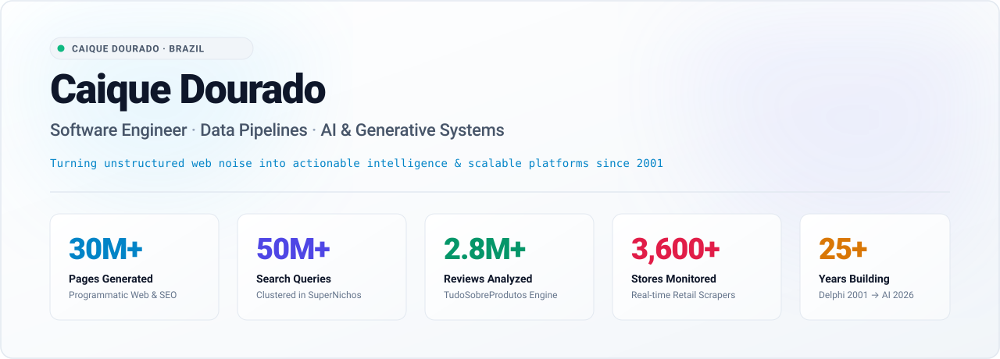
</picture>

**Software Engineer · Data Pipelines · Generative AI Platforms · Brazil**

Building systems that turn web noise into decisions since 2001.

Founder of [TudoSobreProdutos.com.br](https://www.tudosobreprodutos.com.br) and [SuperNichos](https://supernichos.com). Head of Operations at [Agência Disco](https://www.disco-tec.com) (one of Brazil's leading Shopify agencies). Former CMO at Samurai Experts / Locaweb. Advisory Board Member at ABLEC. Over 25 years hands-on, from Delphi 5 in 2001 to distributed AI pipelines in 2026.

[](https://www.linkedin.com/in/caiquedourado/)
[](https://www.kaggle.com/caiquedourado)
[](https://caiquedourado.com.br)
[](https://www.youtube.com/@CaiqueDourado)
[](https://twitter.com/caiquedourado)
[](mailto:contato@tudosobreprodutos.com.br)


## Tech Stack


---

## What I do

I build autonomous systems that discover, ingest, normalize, and interpret massive volumes of unstructured web data, turning raw noise into purchasing intelligence and actionable business decisions.

- **Distributed Crawlers & Data Pipelines:** Resilient scraping infrastructure (Playwright, DrissionPage, curl_cffi, Scrapy, httpx) with smart proxy rotation and anti-bot mitigation across 3,600+ stores.
- **Data Engineering & Deduplication:** Cross-merchant catalog clustering without EAN/SKU using Metaphone, Soundex, N-gram, MinHash, and Perceptual Image Hashing.
- **AI, LLMs & NLP at Scale:** Sentiment extraction from millions of reviews, RAG pipelines, multi-provider LLM orchestration (OpenAI, Gemini, Claude), Whisper transcription, YouTube automation, and neural TTS.
- **Programmatic SEO / AEO / GEO:** Data-driven content generation at scale (30M+ pages); structured data, schema markup, technical SEO, Core Web Vitals. Answer Engine Optimization (Perplexity, ChatGPT Search) and Generative Engine Optimization to position content as the canonical source for AI-generated answers.
- **E-commerce Growth & CRO:** A/B testing (GrowthBook, Optimizely), CRM automation (Klaviyo, Insider), GA4, server-side tracking, conversion funnel optimization.
- **High-Performance Modern Web:** Next.js (SSR/SSG, TypeScript) + async Python backends (FastAPI, Redis, Supabase/PostgreSQL, BigQuery).

---

| | | |
|:---:|:---:|:---:|
| 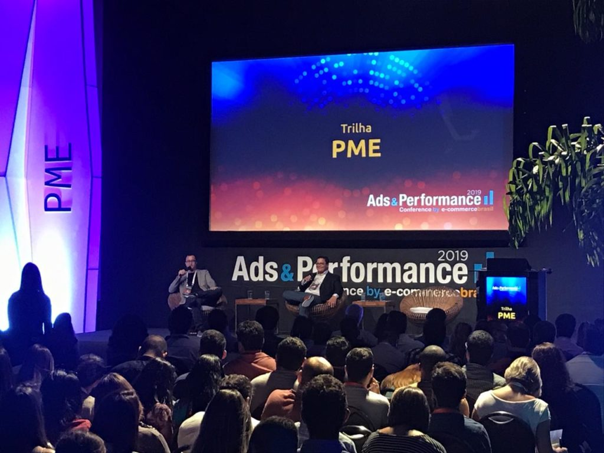 | 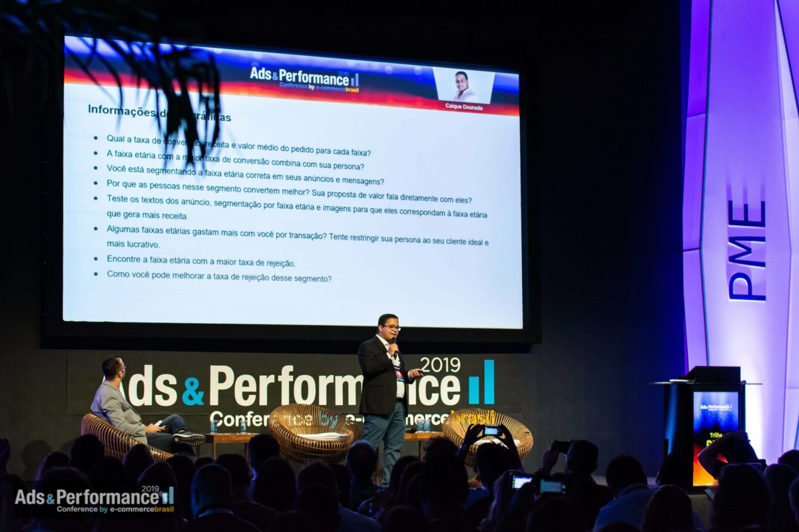 |  |

## Selected work

### [TudoSobreProdutos.com.br](https://www.tudosobreprodutos.com.br) (Product intelligence platform, 2020 / re-architected 2026)

The Brazilian equivalent of RTINGS.com and Versus.com, with added coverage of Brazilian retail prices, 3,600+ stores, and local certifications (INMETRO, ANVISA). Brands do not pay for ranking positions.

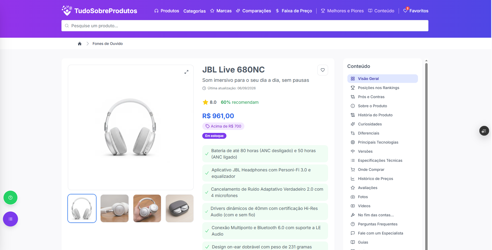

- End-to-end Data Mining & Generative AI platform with a **17-stage ETL pipeline** from raw scraping to structured portals and multimodal distribution
- 2.8M+ real user reviews processed; catalogs monitored across 3,600+ Brazilian stores
- **Evaluation methodology:** 4-step process: specs screening (manufacturers + global data) → Big Data (cross-referencing thousands of real user reviews and expert video transcripts) → AI Engine (chronic failure patterns and real qualities ignored by other sites) → Human curation (specialists validate every data point for context accuracy); 3 rigour pillars: consolidated social proof, long-term durability metrics (not just out-of-box performance), and normalized technical comparability across price tiers
- Custom deduplication pipeline for cross-merchant product matching without EAN/SKU
- **Human-in-the-Loop (HITL)** editorial system: AI generates, humans validate, platform publishes
- **LLM Ops** (`tiktoken`): long-context management (100k+ tokens), chunking, cost optimization and hallucination mitigation
- **Automated video pipeline** (`Remotion`, `moviepy`, `edge-tts`): LLM-generated scripts feed `Remotion` compositions with neural TTS narration, published to YouTube Shorts & TikTok
- **Frontend:** Next.js 16 App Router + ISR (TTFB ~80-150ms on cache hit); 3-layer cache (`React cache()` + `unstable_cache` + Upstash Redis); deployed on Vercel Edge CDN; `shadcn/ui` + Radix UI
- **Observability:** Sentry (runtime errors), Vercel Analytics, Speed Insights (Core Web Vitals in production)
- **Agent-ready architecture:** `llms.txt`, MCP Server Card, ARD 1.0 catalog, `agent-skills.json`; `Accept: text/markdown` content negotiation via `turndown` (HTML-to-Markdown pipeline); server-side OG image generation via `@napi-rs/canvas`
- **AEO / GEO:** Custom 12-step HTML-to-Markdown pipeline (`lib/markdown-for-agents.ts`) that strips 95%+ of UI noise from Next.js pages for LLM consumption (1.55 MB HTML down to 64 KB Markdown, 86 images deduplicated to 8); `Content-Signal` directives in `robots.txt` (`ai-train=no, search=yes`); canonical attribution header injected into every Markdown response
- **Open source from this pipeline:** [scrapladder](https://github.com/CaiqueDourado/scrapladder) · [transcriptladder](https://github.com/CaiqueDourado/transcriptladder) · [llm-cost-kit](https://github.com/CaiqueDourado/llm-cost-kit) · [llm-batch-kit](https://github.com/CaiqueDourado/llm-batch-kit) · [pros-e-contras-ptbr](https://github.com/CaiqueDourado/pros-e-contras-ptbr) · [DedupKit](https://github.com/CaiqueDourado/DedupKit)

**System workflow:**


**Live examples:**

| Type | URL |
|:---|:---|
| Product page | [Apple AirPods Pro 3](https://www.tudosobreprodutos.com.br/fones-de-ouvido/apple-airpods-pro-3) |
| Comparison | [AirPods Pro 2 vs AirPods Pro 3](https://www.tudosobreprodutos.com.br/fones-de-ouvido/comparacoes/apple-airpods-pro-2-x-apple-airpods-pro-3) |
| Ranking Top 10 | [Top 4 Apple Headphones](https://www.tudosobreprodutos.com.br/fones-de-ouvido/melhores/top-4-fones-de-ouvido-apple-qual-vale-mais-a-pena) |
| Article | [U-shape vs V-shape vs Neutral Sound](https://www.tudosobreprodutos.com.br/fones-de-ouvido/artigos/assinaturas-sonoras-explicadas-u-shape-vs-v-shape-vs-neutro) |

**Videos generated by the Remotion pipeline:**

| | |
|:---:|:---:|
| [](https://www.youtube.com/watch?v=zbM5CcOTwac) | [](https://www.youtube.com/watch?v=5rFta5DY1KI) |

**Website www.tudosobreprodutos.com.br:**


---

### [scrapladder](https://github.com/CaiqueDourado/scrapladder)
*Fetch web pages by climbing an escalating ladder of methods, remembering per domain which rung worked.*

[](https://github.com/CaiqueDourado/scrapladder)

Climbs an escalating ladder of fetching layers — from plain HTTP (`requests`, `httpx`), real browser TLS impersonation (`curl_cffi`), headless browsers (Playwright, Camoufox, Scrapling), to paid scraping APIs — remembering which rung succeeded per domain and skipping blocked rungs automatically.

```python
from scrapladder import Ladder

with Ladder(memory="scrapladder.json") as ladder:
    r = ladder.fetch("https://loja.example.com.br/produto/123", must_contain="KZ ZSN Pro")

if r.ok:
    print(r.method, len(r.html))   # e.g. curl_cffi 184213
else:
    print(r.summary())             # e.g. blocked via - [curl_cffi:challenged > playwright:challenged]
```

[](https://github.com/CaiqueDourado/scrapladder)
[](https://github.com/CaiqueDourado/scrapladder)
[](https://github.com/CaiqueDourado/scrapladder/blob/main/LICENSE)

---

### [transcriptladder](https://github.com/CaiqueDourado/transcriptladder)
*Resilient YouTube transcripts that keep working: direct captions, yt-dlp metadata, and neural Whisper fallback.*

[](https://github.com/CaiqueDourado/transcriptladder)

Tries caption extraction in cascading resilience order (`youtube-transcript-api` → plain caption URL download → `yt-dlp` subtitle extraction → local `faster-whisper`), adapting dynamically as YouTube updates its pages.

```python
from transcriptladder import Transcriber

with Transcriber(languages=["pt", "en"], memory="transcriptladder.json") as t:
    r = t.transcribe("https://youtu.be/VIDEO_ID")

if r.ok:
    print(r.method, r.language)      # e.g. yt_dlp_subs pt
    print(r.text[:300])
    open("video.srt", "w").write(r.srt())
```

[](https://github.com/CaiqueDourado/transcriptladder)
[](https://github.com/CaiqueDourado/transcriptladder)
[](https://github.com/CaiqueDourado/transcriptladder/blob/main/LICENSE)
---

### [llm-cost-kit](https://github.com/CaiqueDourado/llm-cost-kit)
*Know what each LLM call really costs, with prices you can trace back to the provider's page.*

[](https://github.com/CaiqueDourado/llm-cost-kit)

Tracks the true cost of every LLM call — prompt, cached, output, and thinking tokens — across OpenAI, Gemini, Claude and DeepSeek, with per-call price tables you can trace back to the provider's pricing page. Born from a real cost audit that cut a product's AI bill from US$1.00 to US$0.14 (−85.8%).

```python
from llm_cost_kit import Ledger, PriceTable, SQLiteSink, target, timer

prices = PriceTable.load("prices.yaml")   # every price has source and checked_at
ledger = Ledger(prices, SQLiteSink("costs.sqlite"))

for product in products:
    with target(product_id=product["id"]):
        with timer() as t:
            resp = client.models.generate_content(model="gemini-2.5-flash", contents=prompt)
        ledger.record(resp, model="gemini-2.5-flash", flow="spec_sheet", latency_ms=t.ms)
```

```bash
$ llm-cost-kit report costs.sqlite --by meta.product_id
$ llm-cost-kit prices prices.yaml        # stale or suspicious prices
$ llm-cost-kit check src/ --recorder record   # scripts calling LLMs without metering
```

[](https://github.com/CaiqueDourado/llm-cost-kit)
[](https://github.com/CaiqueDourado/llm-cost-kit)
[](https://github.com/CaiqueDourado/llm-cost-kit/blob/main/LICENSE)

---

### [SimilarImageFinder](https://github.com/CaiqueDourado/SimilarImageFinder)
*Find duplicate and near-duplicate product photos with perceptual image hashing — Python and .NET return the same bits.*

[](https://github.com/CaiqueDourado/SimilarImageFinder)

Perceptual hashing (aHash, dHash, pHash) that finds near-duplicate images even after resize, recompression, or brightness edits. Forged from 5 years managing 114M product offers from 7,179 Brazilian stores — where the same photo from different merchants never had the same SHA-256.

```python
from similar_image_finder import perceptual_hash

a = perceptual_hash("store-a/lamp.jpg")
b = perceptual_hash("store-b/pendente-preto-600x600.webp")
print(a - b)   # Hamming distance: 0-6 = same picture, >20 = different product
```

```csharp
using SimilarImageFinder;

var a = ImageLoader.Hash("store-a/lamp.jpg");          // pHash, 64 bits
var b = ImageLoader.Hash("store-b/pendente.webp");
Console.WriteLine(a - b);                             // Hamming distance
```

[](https://github.com/CaiqueDourado/SimilarImageFinder)
[](https://github.com/CaiqueDourado/SimilarImageFinder)
[](https://github.com/CaiqueDourado/SimilarImageFinder)
[](https://github.com/CaiqueDourado/SimilarImageFinder/blob/main/LICENSE)

---

### Open Source Libraries & Developer Tools

<table>
<tr>
  <td width="72" align="center">
    <a href="https://github.com/CaiqueDourado/scrapladder"></a>
  </td>
  <td>
    <a href="https://github.com/CaiqueDourado/scrapladder"><b>scrapladder</b></a>: Fetch web pages by climbing an escalating ladder of methods (plain HTTP, curl_cffi TLS impersonation, Playwright, paid scraping APIs) and remember per domain which rung worked.<br>
    <a href="https://github.com/CaiqueDourado/scrapladder"></a>
    
  </td>
</tr>
<tr>
  <td width="72" align="center">
    <a href="https://github.com/CaiqueDourado/transcriptladder"></a>
  </td>
  <td>
    <a href="https://github.com/CaiqueDourado/transcriptladder"><b>transcriptladder</b></a>: Resilient YouTube transcription combining caption APIs, yt-dlp metadata, and faster-whisper neural fallback. Generates clean text, timed segments, and SRT.<br>
    <a href="https://github.com/CaiqueDourado/transcriptladder"></a>
    
  </td>
</tr>
<tr>
  <td width="72" align="center">
    <a href="https://github.com/CaiqueDourado/DedupKit"></a>
  </td>
  <td>
    <a href="https://github.com/CaiqueDourado/DedupKit"><b>DedupKit</b></a>: Cross-merchant product deduplication for Brazilian Portuguese e-commerce. Identifies matching listings without EAN/SKU and rejects false positives (Python &amp; .NET with identical results).<br>
    <a href="https://github.com/CaiqueDourado/DedupKit"></a>
    
  </td>
</tr>
<tr>
  <td width="72" align="center">
    <a href="https://github.com/CaiqueDourado/search-pattern-miner"></a>
  </td>
  <td>
    <a href="https://github.com/CaiqueDourado/search-pattern-miner"><b>search-pattern-miner</b></a>: Turns search queries into page templates (<code>como fazer [comida]</code>) with the 7 algorithms behind SuperNichos: prefixes, n-grams, skip-grams, bags of words and entity replacement, plus volume/CPC ranking (Python &amp; .NET with identical results).<br>
    <a href="https://github.com/CaiqueDourado/search-pattern-miner"></a>
    
  </td>
</tr>
<tr>
  <td width="72" align="center">
    <a href="https://github.com/CaiqueDourado/llm-cost-kit"></a>
  </td>
  <td>
    <a href="https://github.com/CaiqueDourado/llm-cost-kit"><b>llm-cost-kit</b></a>: Calculate exact pricing and token costs for LLM inference calls across OpenAI, Anthropic Claude, Google Gemini, and open models with up-to-date sources.<br>
    <a href="https://github.com/CaiqueDourado/llm-cost-kit"></a>
    
  </td>
</tr>
<tr>
  <td width="72" align="center">
    <a href="https://github.com/CaiqueDourado/llm-batch-kit"></a>
  </td>
  <td>
    <a href="https://github.com/CaiqueDourado/llm-batch-kit"><b>llm-batch-kit</b></a>: Provider Batch APIs at half price without mismatched answers or paying twice: (prompt, item) pairs, signed manifest, idempotent collection and a Postgres in-flight queue.<br>
    <a href="https://github.com/CaiqueDourado/llm-batch-kit"></a>
    
  </td>
</tr>
<tr>
  <td width="72" align="center">
    <a href="https://github.com/CaiqueDourado/SimilarImageFinder"></a>
  </td>
  <td>
    <a href="https://github.com/CaiqueDourado/SimilarImageFinder"><b>SimilarImageFinder</b></a>: Perceptual image hashing engine (aHash, dHash, pHash, wHash) for large-scale e-commerce product image deduplication and catalog clustering.<br>
    <a href="https://github.com/CaiqueDourado/SimilarImageFinder"></a>
  </td>
</tr>
<tr>
  <td width="72" align="center">
    <a href="https://github.com/CaiqueDourado/BrCommerceKit"></a>
  </td>
  <td>
    <a href="https://github.com/CaiqueDourado/BrCommerceKit"><b>BrCommerceKit</b></a>: Brazilian e-commerce engineering toolkit for .NET / C#. Platform fingerprinting across 20 engines (Shopify, VTEX, Nuvemshop, Loja Integrada), streaming feed parser for Brazilian dialects (<code>preco_por</code>, <code>g:</code>), Shopify <code>products.json</code> reader, BRL price normalizer, and catalog quality inspector (placeholder images and generic EAN detection).<br>
    <a href="https://github.com/CaiqueDourado/BrCommerceKit"></a>
    
    
  </td>
</tr>
<tr>
  <td width="72" align="center">
    <a href="https://github.com/CaiqueDourado/PtBr.Text"></a>
  </td>
  <td>
    <a href="https://github.com/CaiqueDourado/PtBr.Text"><b>PtBr.Text</b></a>: Brazilian Portuguese text &amp; data engineering toolkit for .NET. Validation and formatting for CPF, new alphanumeric CNPJ, CEP, and 9-digit phones. Includes data-to-text generation (gender/plural agreement), RAKE PT-BR keyword extraction with essential stopwords, and contact extraction.<br>
    <a href="https://github.com/CaiqueDourado/PtBr.Text"></a>
    
    
  </td>
</tr>
<tr>
  <td width="72" align="center">
    <a href="https://github.com/CaiqueDourado/pros-e-contras-ptbr"></a>
  </td>
  <td>
    <a href="https://github.com/CaiqueDourado/pros-e-contras-ptbr"><b>pros-e-contras-ptbr</b></a>: Top pros and cons of a product from its Brazilian Portuguese reviews. No API, no model download; lexicon learned from 11.7M real review clauses.<br>
    <a href="https://github.com/CaiqueDourado/pros-e-contras-ptbr"></a>
    
    
  </td>
</tr>
<tr>
  <td width="72" align="center">
    <a href="https://github.com/CaiqueDourado/DomainCheck"></a>
  </td>
  <td>
    <a href="https://github.com/CaiqueDourado/DomainCheck"><b>DomainCheck</b></a>: Is this domain available? Registro.br for <code>.br</code>, WHOIS discovered through IANA for every other extension, a DNS pre-check and a name generator.<br>
    <a href="https://github.com/CaiqueDourado/DomainCheck"></a>
    
    
  </td>
</tr>
<tr>
  <td width="72" align="center">
    <a href="https://github.com/CaiqueDourado/ibge-nomes"></a>
  </td>
  <td>
    <a href="https://github.com/CaiqueDourado/ibge-nomes"><b>ibge-nomes</b></a>: Python client for IBGE’s names API (2010 Census): rank, frequency, state, gender and decade. Standard library only.<br>
    <a href="https://github.com/CaiqueDourado/ibge-nomes"></a>
    
    
  </td>
</tr>
<tr>
  <td width="72" align="center">
    <a href="https://br.wordpress.org/plugins/people-also-ask/"></a>
  </td>
  <td>
    <a href="https://br.wordpress.org/plugins/people-also-ask/"><b>People Also Ask Plugin</b></a>: Official WordPress.org plugin automating programmatic SEO content from Google SERP "People Also Ask" questions. Features multi-level scraping, automated Schema Markup, and YouTube embeds.<br>
    <a href="https://br.wordpress.org/plugins/people-also-ask/"></a>
    <a href="https://www.youtube.com/watch?v=txbozF2zYZA"></a>
    
  </td>
</tr>
<tr>
  <td width="72" align="center">
    <a href="https://supernichos.com"></a>
  </td>
  <td>
    <a href="https://supernichos.com"><b>SuperNichos</b></a>: Brazil's largest niche discovery and segment mining engine. Ingests 50M Google Brazil queries, normalizing and clustering terms with Metaphone, Soundex, MinHash, and N-gram algorithms.<br>
    <a href="https://supernichos.com"></a>
    <a href="https://www.youtube.com/watch?v=kR3OM_zQE30&t=385s"></a>
    
  </td>
</tr>
</table>

---

### Open Datasets & Scale Highlights

| | Repository / Dataset | Volume / Scale | Focus & Description |
| :---: | :--- | :--- | :--- |
| <a href="https://github.com/CaiqueDourado/google-keywords-dataset"></a> | [**google-keywords-dataset**](https://github.com/CaiqueDourado/google-keywords-dataset) · [Kaggle](https://www.kaggle.com/datasets/caiquedourado/google-keywords-dataset) | **38M searches**, 1.73M patterns, 138M pattern → search pairs | Google keywords with volume, CPC and competition (Brazil, US, Spain, Argentina), search patterns of five algorithms and hand-made curation labels; the data behind SuperNichos. |
| <a href="https://github.com/CaiqueDourado/brazilian-ecommerce-products"></a> | [**brazilian-ecommerce-products**](https://github.com/CaiqueDourado/brazilian-ecommerce-products) · [Kaggle](https://www.kaggle.com/datasets/caiquedourado/catalogo-produtos-ecommerce-brasil) | **114M offers** (7,179 stores) | Massive open Brazilian e-commerce price and product offers catalog. |
| <a href="https://github.com/CaiqueDourado/portuguese-product-reviews"></a> | [**portuguese-product-reviews**](https://github.com/CaiqueDourado/portuguese-product-reviews) · [Kaggle](https://www.kaggle.com/datasets/caiquedourado/reviews-produtos-ptbr) | **2.87M reviews** | Brazilian product reviews dataset with sentiment classification and extracted pros/cons. |
| <a href="https://github.com/CaiqueDourado/product-matching-pairs-portuguese"></a> | [**product-matching-pairs-portuguese**](https://github.com/CaiqueDourado/product-matching-pairs-portuguese) · [Kaggle](https://www.kaggle.com/datasets/caiquedourado/pares-matching-produtos-ptbr) | **2.1M labelled pairs** | Benchmark dataset of product offers labeled for deduplication and fuzzy match validation. |
| <a href="https://github.com/CaiqueDourado/lojas-virtuais-brasil"></a> | [**lojas-virtuais-brasil**](https://github.com/CaiqueDourado/lojas-virtuais-brasil) · [Kaggle](https://www.kaggle.com/datasets/caiquedourado/lojas-virtuais-brasil) | **63,974 stores** | Census of Brazilian online stores with platform fingerprinting, SSL verification, and CNPJ data. |
| <a href="https://github.com/CaiqueDourado/fipe-ficha-tecnica-veiculos"></a> | [**fipe-ficha-tecnica-veiculos**](https://github.com/CaiqueDourado/fipe-ficha-tecnica-veiculos) · [Kaggle](https://www.kaggle.com/datasets/caiquedourado/fipe-ficha-tecnica-veiculos) | **1.65M FIPE prices**, 37,794 versions, 25.5M part pairs | Brazilian vehicle prices 2020–2026 (cars, motorcycles, trucks), specifications and vehicle × auto part matches. |
| <a href="https://github.com/CaiqueDourado/brazilian-names-surnames"></a> | [**brazilian-names-surnames**](https://github.com/CaiqueDourado/brazilian-names-surnames) · [Kaggle](https://www.kaggle.com/datasets/caiquedourado/nomes-e-sobrenomes-brasil) | **46,840 names, 27,047 surnames** | Brazilian given names and surnames with IBGE Census frequencies, phonetic keys and meanings. |
| <a href="https://github.com/CaiqueDourado/municipios-e-estados-do-brasil"></a> | [**municipios-e-estados-do-brasil**](https://github.com/CaiqueDourado/municipios-e-estados-do-brasil) · [Kaggle](https://www.kaggle.com/datasets/caiquedourado/municipios-e-estados-do-brasil) | **5,570 municipalities** | All 5,570 Brazilian cities, 27 states, IBGE codes, and geographic metadata. |
| <a href="https://github.com/CaiqueDourado/palavras-da-biblia"></a> | [**palavras-da-biblia**](https://github.com/CaiqueDourado/palavras-da-biblia) · [Kaggle](https://www.kaggle.com/datasets/caiquedourado/palavras-da-biblia) | **592,643 words**, 30,127 distinct | Word frequencies of the Portuguese Bible (Almeida 1993) by book and Testament, characteristic words and quoted excerpts. |
| <a href="https://github.com/CaiqueDourado/dicionario-portugues"></a> | [**dicionario-portugues**](https://github.com/CaiqueDourado/dicionario-portugues) · [Kaggle](https://www.kaggle.com/datasets/caiquedourado/dicionario-portugues) | **272k words**, 2.9M AI texts, 2.3M rhymes | Portuguese word list with phonetic keys, stems, frequency and rhymes, plus meaning, synonyms and grammar written by GPT-3.5 and davinci (not reviewed); the data behind Tudo sobre as Palavras. |
| <a href="https://github.com/CaiqueDourado/portuguese-entity-gazetteer"></a> | [**portuguese-entity-gazetteer**](https://github.com/CaiqueDourado/portuguese-entity-gazetteer) · [Kaggle](https://www.kaggle.com/datasets/caiquedourado/portuguese-entity-gazetteer) | **307k entities**, 747 types, 26 classes | Portuguese gazetteer of places, people, works, products and brands with their types, curated by hand; the entity dictionary behind SuperNichos' search patterns. |
| <a href="https://github.com/CaiqueDourado/brazilian-notary-registry-offices"></a> | [**brazilian-notary-registry-offices**](https://github.com/CaiqueDourado/brazilian-notary-registry-offices) · [Kaggle](https://www.kaggle.com/datasets/caiquedourado/brazilian-notary-registry-offices) | **16,266 offices**, sample of 1,009 with revenue 2005–2026 | Brazilian notary and registry offices (cartórios) from the CNJ registry: services, acts and revenue per semester, Corregedoria decisions; personal data masked. |
| <a href="https://github.com/CaiqueDourado/paises-do-mundo-ptbr"></a> | [**paises-do-mundo-ptbr**](https://github.com/CaiqueDourado/paises-do-mundo-ptbr) · [Kaggle](https://www.kaggle.com/datasets/caiquedourado/paises-do-mundo-ptbr) | **167 countries**, 53 columns | ISO codes, Brazilian Portuguese names, languages, currencies, time zones and regional formats. |
| <a href="https://github.com/CaiqueDourado/taxonomia-google-produtos-ptbr"></a> | [**taxonomia-google-produtos-ptbr**](https://github.com/CaiqueDourado/taxonomia-google-produtos-ptbr) · [Kaggle](https://www.kaggle.com/datasets/caiquedourado/taxonomia-google-produtos-ptbr) | **5,595 categories** | Google's product taxonomy in Portuguese and English: flat table, closure table and JSON tree. |

---

### [SuperNichos](https://supernichos.com) (Niche & keyword mining tool, 2023-present)
- 700,000 niches and 50M+ keywords in a single platform
- Largest niche discovery and segment mining tool in Brazil
- **Origin story:** [What I learned breaking down 50 million Google searches](https://caiquedourado.com.br/o-que-aprendi-debulhando-50-milhoes-de-termos-de-busca-no-google/) (2023, in Portuguese): the spreadsheet that became the tool

**How it was built:**
1. **Data Ingestion:** Processed 55M Google search queries with volume, CPC and competition (Keyword Planner metrics via Ubersuggest in 2018, plus DataForSEO for Brazil, the US, Spain and Argentina).
2. **Normalization & Clustering:** Normalized search queries and grouped terms to uncover semantic and textual patterns using string similarity algorithms (Metaphone, Soundex, N-gram, MinHash, Fingerprint, NgramKeyer).
3. **Mining & Discovery:** Clustered final data to uncover thousands of profitable niches and market opportunities (for product development, service offerings, addressing unmet customer pain points, and programmatic SEO).

- **Open data & code:** [google-keywords-dataset](https://github.com/CaiqueDourado/google-keywords-dataset) (38M searches, 1.73M patterns of five algorithms, 154k patterns labelled by hand) · [search-pattern-miner](https://github.com/CaiqueDourado/search-pattern-miner) (the algorithms, rewritten in Python and .NET) · [portuguese-entity-gazetteer](https://github.com/CaiqueDourado/portuguese-entity-gazetteer) (the 307k-entity dictionary behind the [tipo] patterns) · article: [Seven ways to turn millions of Google searches into page templates](https://medium.com/@caiquedourado/seven-ways-to-turn-millions-of-google-searches-into-page-templates-3671235eac0f)

[](https://www.youtube.com/watch?v=kR3OM_zQE30&t=385s)

### [Gambis Mode [On]](https://caiquedourado.com.br) (Independent Venture: Programmatic SEO & Data Mining, 2017-present)
Independent software engineering and programmatic SEO laboratory responsible for the architecture, deployment, and monetization of **over 40 production web platforms**.
- **Scale:** Over 30 million indexed pages generated from massive open datasets (Apple Enterprise Partner Feed, DBpedia, Freebase, IMDB, MusicBrainz, MovieLens, Open Food Facts, Tabela FIPE, Brazilian Federal Revenue CNPJs, Correios CEPs, Quotes, Bible)
- **Data Engineering & NLP:** Entity deduplication with OpenRefine, phonetic and string similarity algorithms (Metaphone, Soundex, N-gram, MinHash), and syntactic parsing via Stanford NLP (POS Tagger)
- **Infrastructure & Automation:** Distributed multi-proxy scrapers (Selenium, Chrome Headless, Cloudflare Workers, anti-captcha mitigation), dynamic banner rendering in C# (`System.Drawing.Image`), and serverless edge hosting on Google Cloud Storage
- **Monetization & AdTech Ecosystem:** Large-scale commercial monetization through header bidding, ad exchanges, and affiliate networks (Google Ad Manager, Google AdSense, Awin, Lomadee, Rakuten Marketing, Amazon Associates, Taboola, Teads, MGID, Seedtag, Rubicon, RTB House, Cazamba, Clever Advertising)

### Agência Disco (Head of Operations, 2023-present)
Shopify e-commerce growth for brands such as Chocolates Dengo, Rommanel, Malwee, CIMED, Garmin, Contém 1G, Bold Snacks, Tânia Bulhões, and 20+ more.
- Growth Marketing, CRO, Programmatic SEO, A/B Testing (GrowthBook)
- CRM & marketing automation (Klaviyo, Insider, Shopify Email, n8n, Shopify Flow)
- GA4, server-side tracking, Customer Events, analytics & BI

### Samurai Experts / Locaweb (CMO & Growth, 2021-2023)
- Chief Marketing Officer, Growth Hacker
- Branding Manager at Wake (wake.tech)

### Editora Juspodivm (Head of E-commerce, 2014-2021, 7+ years)
- Scaled the team from 1 to 8 people; became the largest e-commerce in Brazil's North/Northeast region
- Full ERP + e-commerce platform migration (flipped in a single day in 2016)
- **e-Bit Diamond Seal** (one of only 3 companies in the Brazilian book segment)
- **RA1000** by Reclame Aqui (top reputation seal)
- Stack: Moovin, e-Millennium ERP, Konduto, SendGrid, Maxipago, AWS, Cloudflare, Criteo, Optimizely

### [Google Analytics Real Time Dashboard](https://caiquedourado.com.br/dashboard-em-tempo-real-para-acompanhamento-seu-e-commerce/) (2017)
Real-time analytics and channel monitoring dashboard built for e-commerce operations.
- Real-time traffic, conversion, and acquisition channel monitoring
- Adopted and used by more than 5,000 e-commerce stores

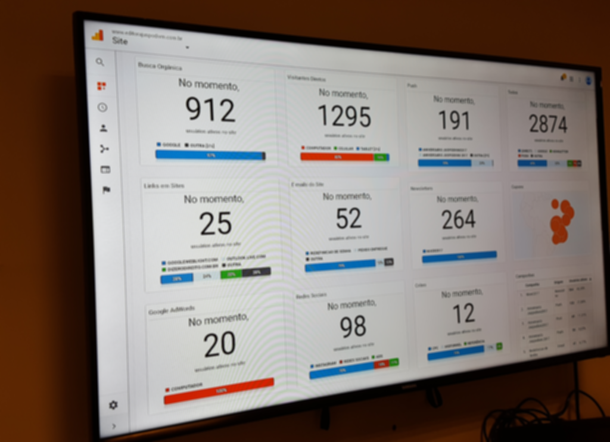

### Cupons VIP (Co-founder & CTO, 2011-2013)
Built from scratch in ASP.NET + SQL Server + Azure (9 months of development, nights and weekends). Acted as CTO and hands-on entrepreneur across all operational and engineering fronts:
- **Product Development:** Full-stack architecture (Frontend, Backend in ASP.NET and SQL Server)
- **Infrastructure & Hosting:** Server management and edge monitoring on Azure CDN and Cloudflare
- **Customer Success:** Scaled support quality to earn the prestigious **RA1000** seal (top reputation on Reclame Aqui)
- **Email Deliverability:** Maintained 99% sender IP reputation across SenderBase, SenderScore, and Microsoft SNDS
- **High-Volume Email Marketing:** Scaled transactional and promotional campaigns to 2M emails/month
- **Growth:** In 1.5 years, grew from 0 to 140,000 monthly pageviews and ~40,000 customers across Salvador, Fortaleza, and Recife; formal partnerships with iBahia and Microsoft Azure

| | |
|:---:|:---:|
| 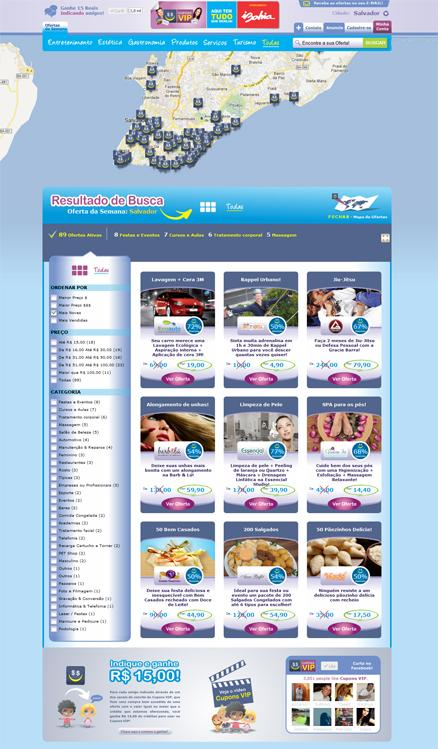 | 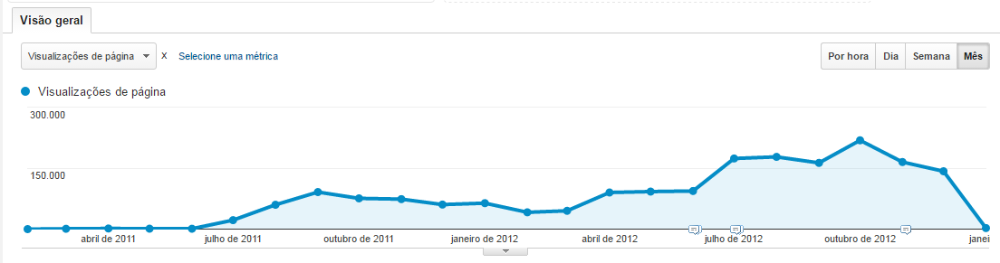 |

### "Baralho do Crime" (2011, viral government project)
- Delivered overnight for Bahia's Public Security Secretary (Pacto pela Vida)
- 10,000 visitors in a single day; covered widely across national press
- Significant media coverage:
  - [G1 / Globo: Segurança Pública da Bahia divulga Baralho do Crime](http://g1.globo.com/bahia/noticia/2011/06/seguranca-publica-da-bahia-divulga-baralho-do-crime.html)
  - [UOL Notícias: Governo da Bahia lança jogo na internet para deter criminosos](http://noticias.uol.com.br/ultimas-noticias/efe/2011/06/03/governo-da-bahia-lanca-jogo-na-internet-para-deter-criminosos.jhtm)

| | |
|:---:|:---:|
|  | 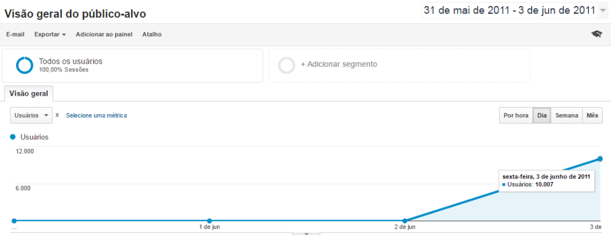 |

### Open Source & Publications
- Articles (2026), on Medium: [Seven ways to turn millions of Google searches into page templates](https://medium.com/@caiquedourado/seven-ways-to-turn-millions-of-google-searches-into-page-templates-3671235eac0f) · [Almost 400 million search patterns, five databases, and what actually worked](https://medium.com/@caiquedourado/almost-400-million-search-patterns-five-databases-and-what-actually-worked-139cb4a28c4e) · [From 1.7 million search patterns to 83 sites: how I chose what to build](https://medium.com/@caiquedourado/from-1-7-million-search-patterns-to-83-sites-how-i-chose-what-to-build-f764687dfe12) · all in [articles](https://github.com/CaiqueDourado/articles)
- Data and NLP articles (2026): [Metaphone, Soundex, n-grams and MinHash on Brazilian product names](https://github.com/CaiqueDourado/articles/blob/main/text-similarity/README.md) · [Finding the same photo across 7,179 stores](https://github.com/CaiqueDourado/articles/blob/main/image-similarity/README.md) · [Sentence splitting + sentiment analysis = pros and cons](https://github.com/CaiqueDourado/articles/blob/main/pros-and-cons/README.md) · [Enriching sign-up data with open APIs](https://github.com/CaiqueDourado/articles/blob/main/open-apis/README.md) · [Training Stanford NER on Portuguese with a dictionary](https://github.com/CaiqueDourado/articles/blob/main/stanford-ner/README.md) · [What I learned squeezing 50 million searches](https://github.com/CaiqueDourado/articles/blob/main/fifty-million-searches/README.md)
- Older articles: *Push Notifications guide*

---

## Programmatic SEO Projects

Large-scale programmatic architectures developed since 2020, generating millions of indexed organic pages through autonomous web crawling, catalog entity resolution, NLP sentiment analysis, and serverless edge delivery.

### [Tudo Sobre Produtos - 1st Version](https://web.archive.org/web/20251021032358/https://tudosobreprodutos.com.br/tudo-sobre-bebedouro-cadence-pure-vita-elegant-0v) (2020)
Comprehensive online product intelligence guide with detailed specifications, real user reviews, and comparisons.
- **Scale:** 280,000 products extracted from XML feeds across 4,800 Brazilian e-commerce stores
- **Social proof:** 2,871,096 user reviews collected via Bazaarvoice API
- **Web scraping:** Automated crawler for technical specification sheets across merchant stores
- **Entity resolution challenge:** Clustering 280,000 products from different stores with conflicting naming conventions and missing EAN/SKU
- **Deduplication solution:** Multi-algorithm fuzzy matching on product titles (Metaphone, Soundex, N-gram, MinHash) combined with perceptual image hashing ([ImageHash](https://github.com/coenm/ImageHash))
- **NLP Sentiment extraction:** Pros and Cons generated via sentence splitting with POS Tagger + Sentiment Analysis with Amazon Comprehend ([see architecture presentation](https://docs.google.com/presentation/d/1Y9ShmHLBnlbyZYIlbUPzZ_-QEk0fqIO6UMf-0dZOPQM/edit#slide=id.p))
- **Structured Data:** JSON-LD schemas for FAQ, ItemList, Product, Table, BreadcrumbList, and Article
- **Stack & Architecture:** 100% static HTML generated with C# and SQL Server, deployed to Google Cloud Storage (serverless, infinite scale)
- **Open data & code:** [brazilian-ecommerce-products](https://github.com/CaiqueDourado/brazilian-ecommerce-products) · [portuguese-product-reviews](https://github.com/CaiqueDourado/portuguese-product-reviews) · [product-matching-pairs-portuguese](https://github.com/CaiqueDourado/product-matching-pairs-portuguese) · [DedupKit](https://github.com/CaiqueDourado/DedupKit) · [SimilarImageFinder](https://github.com/CaiqueDourado/SimilarImageFinder) · [pros-e-contras-ptbr](https://github.com/CaiqueDourado/pros-e-contras-ptbr)
- **Live Archive:** [Visit archived site](https://web.archive.org/web/20251021032358/https://tudosobreprodutos.com.br/tudo-sobre-bebedouro-cadence-pure-vita-elegant-0v)

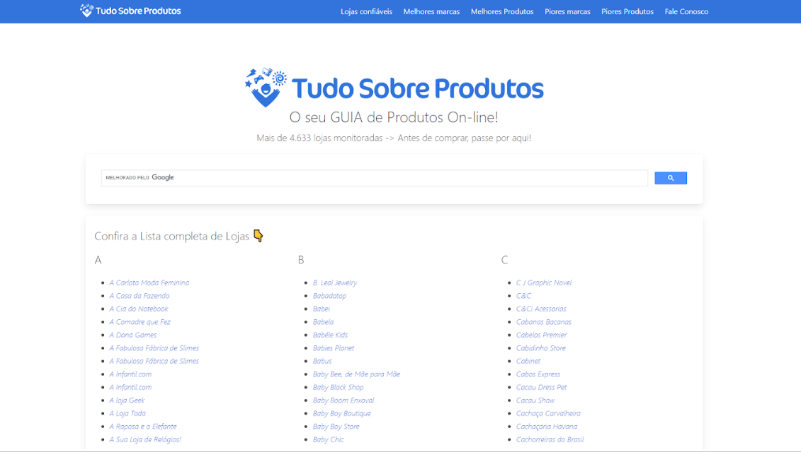

### Portal de Cartórios no Brasil (Brazilian Registry Offices, 2024)
National registry office directory covering all Brazilian municipalities with enriched public records.
- **Scale:** Complete database of all notary and registry offices across Brazilian municipalities
- **Architecture:** One page per office generated from the crawled tables and published on WordPress, with maps and schema markup
- **Audience:** Thousands of monthly organic visits for legal document authentication and certificate requests
- **Open data & code:** [brazilian-notary-registry-offices](https://github.com/CaiqueDourado/brazilian-notary-registry-offices) (a sample of the crawled registry: services, revenue since 2005 and CNJ decisions) · [Kaggle](https://www.kaggle.com/datasets/caiquedourado/brazilian-notary-registry-offices)

### [Nomes e Sobrenomes](https://web.archive.org/web/20250610174857/https://nomessobrenomes.com/qual-o-significado-do-nome-alan-gustavo) (2023)
Platform with 104,000 indexed names, covering meanings, origins, etymology, and numerology.
- **Scale:** 104,000 programmatic pages with full semantic entity coverage
- **Stack:** Built with Next.js 14, Tailwind CSS, TypeScript, Supabase, and OpenAI API
- **Performance:** 100% mobile-friendly with perfect Core Web Vitals scores
- **Structured Data:** JSON-LD schemas for FAQ, ItemList, WebSite, Breadcrumbs, and Article
- **Open data & code:** [brazilian-names-surnames](https://github.com/CaiqueDourado/brazilian-names-surnames) · [ibge-nomes](https://github.com/CaiqueDourado/ibge-nomes)
- **Live Archive:** [Visit archived site](https://web.archive.org/web/20250610174857/https://nomessobrenomes.com/qual-o-significado-do-nome-alan-gustavo)

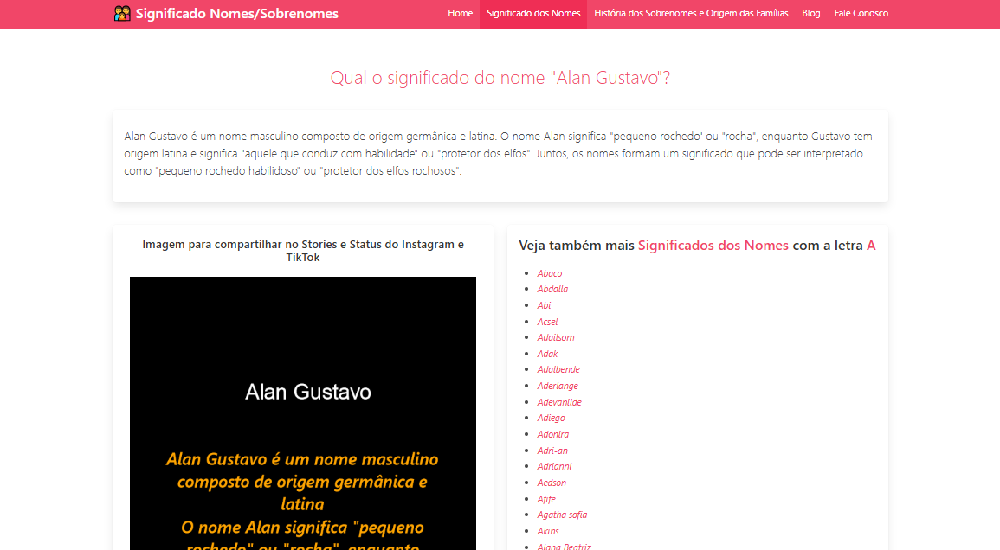

### [Tudo Sobre Lojas](https://web.archive.org/web/20250618081809/https://tudosobrelojas.com/a-loja-saboreat-e-confavel-tudo-sobre-a-loja-saboreat/) (2023)
Comprehensive intelligence and reputational analysis of 63,933 Brazilian e-commerce websites with enriched business data.
- **Coverage:** Scraping and profiling of 63,933 Brazilian online stores
- **Automated Visual Evidence:** Automated headless screenshot generation of Reclame Aqui reputation profiles and store homepages using C# and Selenium
- **Data Enrichment:** Extracted domain owner CNPJ from Whois and cross-referenced with the Federal Revenue database (corporate partners, legal name, trade name, CNPJ, CNAE classification, share capital, physical address, email, phone)
- **Security & Reputation:** Automated SSL certificate verification and direct cross-referencing links to Consumidor.gov.br, Jusbrasil, and Reclame Aqui
- **Platform Detection:** Automatic fingerprinting of e-commerce platforms (Shopify, VTEX, WooCommerce, Nuvemshop, etc.)
- **AI Synthesis:** Contextual explanatory content generated via OpenAI API
- **Open data & code:** [lojas-virtuais-brasil](https://github.com/CaiqueDourado/lojas-virtuais-brasil) · [BrCommerceKit](https://github.com/CaiqueDourado/BrCommerceKit) · [DomainCheck](https://github.com/CaiqueDourado/DomainCheck)
- **Live Archive:** [Visit archived site](https://web.archive.org/web/20250618081809/https://tudosobrelojas.com/a-loja-saboreat-e-confavel-tudo-sobre-a-loja-saboreat/)

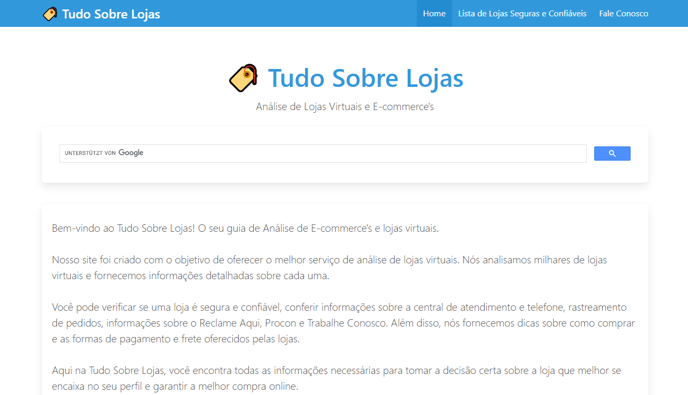

### [Tudo sobre as Palavras](https://web.archive.org/web/20250923215535/https://tudosobreaspalavras.com/tudo-sobre-a-palavra-arrogado) (2023)
Comprehensive Portuguese dictionary platform with 187,000 words, including definitions, synonyms, grammar analysis, and educational exercises.
- **Scale:** 187,000 programmatic pages generated (one for every dictionary entry) combining a pt-BR lexical database with OpenAI API content generation
- **Linguistic Metadata:** Idiomatic and regional definitions, synonyms, antonyms, phonetics and pronunciation, grammatical class, consonants, vowels, root/stem, syllabic division, tonic syllable, singular/plural, gender forms, verb conjugations (infinitive, gerund, past participle), letter counts, educational games, rhymes, and usage examples
- **Visuals:** Dynamic banner and educational graphic generation in C#
- **Architecture:** 100% static HTML generated with C# and SQL Server, hosted on Google Cloud Storage (serverless, infinite scale)
- **Performance:** 100% mobile-friendly with perfect Core Web Vitals scores and JSON-LD schemas
- **Live Archive:** [Visit archived site](https://web.archive.org/web/20250923215535/https://tudosobreaspalavras.com/tudo-sobre-a-palavra-arrogado)
- **Open data & code:** [dicionario-portugues](https://github.com/CaiqueDourado/dicionario-portugues) (272k words, 2.9M AI texts kept with their model, 2.3M rhymes)

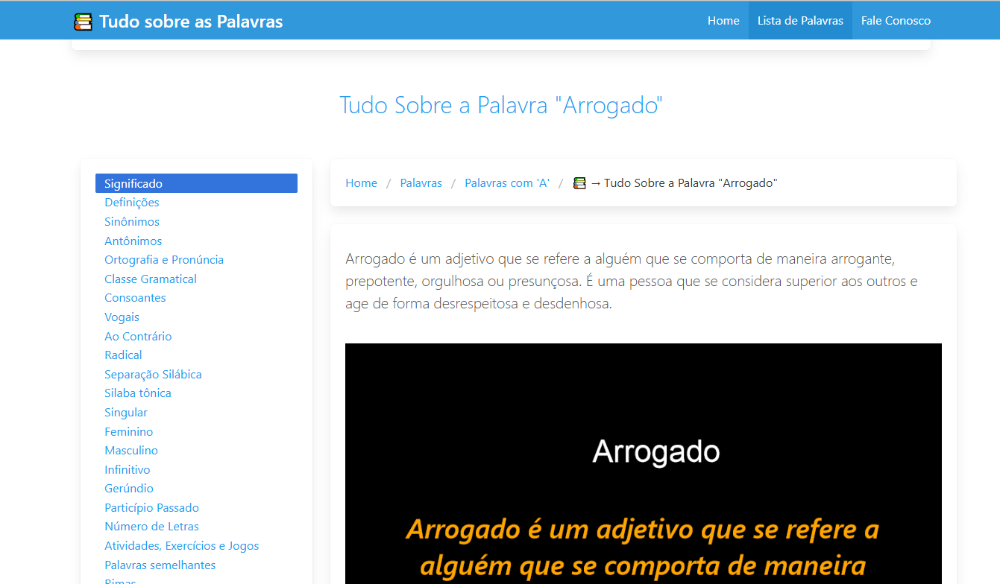

### [Tudo Sobre Carros, Motos e Caminhões](https://web.archive.org/web/20230123215505/https://tudoparaseuscarros.com/) (2022)
Family of four vehicle portals, "auto parts and accessories + specifications + FIPE table", with a page per make, model and version.
- **Sites:** Tudo Sobre Carros, [Tudo para Seus Carros](https://web.archive.org/web/20230123215505/https://tudoparaseuscarros.com/), [Tudo Sobre Motos](https://web.archive.org/web/20230309142752/https://tudosobreduasrodas.com/) and [Tudo Sobre Caminhões](https://web.archive.org/web/20230309142750/https://tudosobrecaminhoes.com/)
- **Scale:** 245 makes and 11,948 FIPE models of cars, motorcycles and trucks; 1.6M monthly FIPE prices; specifications of 37,794 versions
- **Features:** FIPE table and price history, IPVA estimate, specifications and auto parts "that fit this vehicle"
- **Auto parts fitment:** 25.5M vehicle × product pairs matched by model name against the 114M-offer e-commerce catalog, each with a warning level
- **Specifications crawler:** yes/no equipment read from the SVG path of each icon on the page
- **Content:** rule-based Portuguese text for every version (about, equipment, price history, FAQ), no LLM
- **Architecture:** 100% static HTML generated with C# and SQL Server, hosted on Google Cloud Storage
- **Open data & code:** [fipe-ficha-tecnica-veiculos](https://github.com/CaiqueDourado/fipe-ficha-tecnica-veiculos) (with SQLite and JSON releases)
- **Live Archive:** [Tudo para Seus Carros](https://web.archive.org/web/20230123215505/https://tudoparaseuscarros.com/) · [Tudo Sobre Motos](https://web.archive.org/web/20230309142752/https://tudosobreduasrodas.com/) · [Tudo Sobre Caminhões](https://web.archive.org/web/20230309142750/https://tudosobrecaminhoes.com/)

| | |
|:---:|:---:|
| [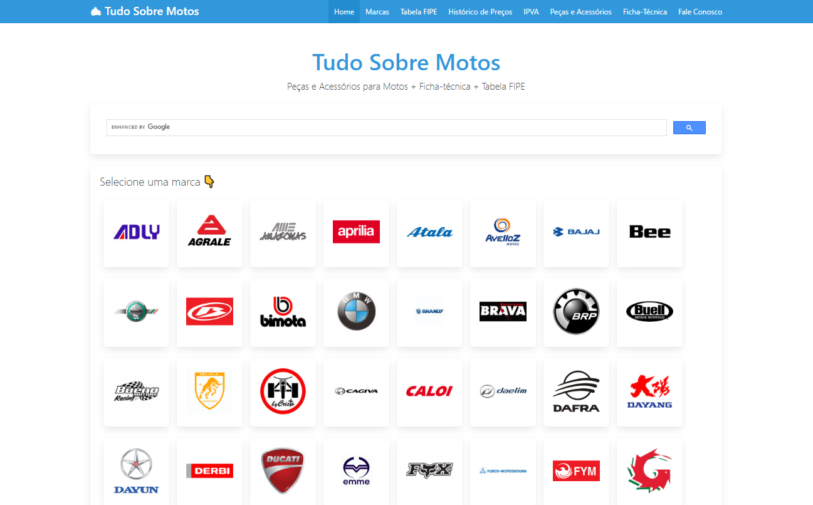](https://web.archive.org/web/20230309142752/https://tudosobreduasrodas.com/) | [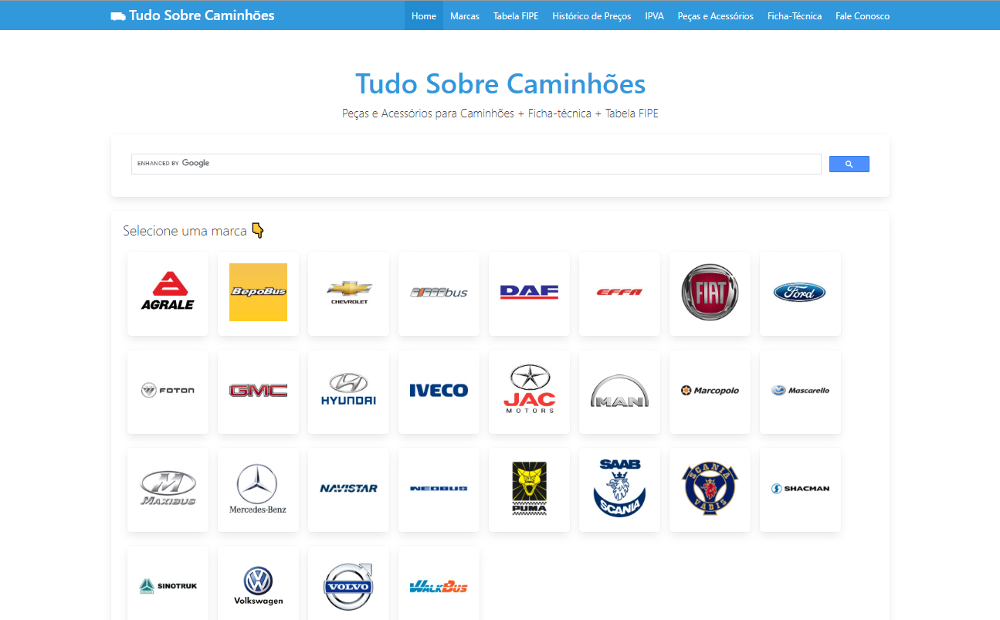](https://web.archive.org/web/20230309142750/https://tudosobrecaminhoes.com/) |

### [Versiculo-Do-Dia.com](https://versiculo-do-dia.com/) (2022)
Bible verse platform with automated programmatic shareable graphics designed for social media distribution.
- **Automated Graphics:** Programmatic generation of high-resolution Bible verse images formatted for social media sharing (Instagram, Facebook, WhatsApp)
- **Database:** Full relational Bible database
- **Engine:** Dynamic image rendering engine in C#
- **Architecture:** 100% static HTML platform hosted on Google Cloud Storage
- **Open data & code:** [palavras-da-biblia](https://github.com/CaiqueDourado/palavras-da-biblia)
- **Live Site:** [Visit site](https://versiculo-do-dia.com/)

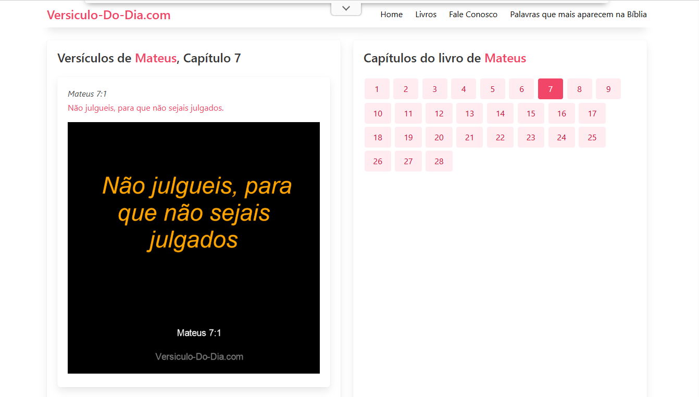

### [919Apps.com](https://web.archive.org/web/20211203115104/https://919apps.com/lca/download-app-mhs-schedule) (2022)
Programmatic discovery catalog generated from the [Apple Enterprise Partner Feed](https://performance-partners.apple.com/epf) (EPF), indexing 2.4 million apps.
- **Scale:** 2.4M apps ingested and indexed from the official [Apple Enterprise Partner Feed](https://performance-partners.apple.com/epf)
- **Internationalization:** Multi-language catalog published across 176 countries
- **Regionalization:** Advanced cultural and geographic formatting implemented using C# `System.Globalization.CultureInfo` and `System.Globalization.RegionInfo`
- **Open data & code:** [paises-do-mundo-ptbr](https://github.com/CaiqueDourado/paises-do-mundo-ptbr)
- **Live Archive:** [Visit archived site](https://web.archive.org/web/20211203115104/https://919apps.com/lca/download-app-mhs-schedule)


### [People Also Ask Plugin](https://br.wordpress.org/plugins/people-also-ask/) (WordPress Plugin, 2024-2026)
Official WordPress plugin published on the WordPress.org repository, automating programmatic SEO content generation based on real-time Google "People Also Ask" SERP data.
- **SERP Scraping:** Multi-level extraction of Google questions and answers via SerpAPI and DataForSEO API
- **Automated Publishing:** Automatically structures content into headings (H2/H3), FAQ schemas, and contextual YouTube video embeds
- **Architecture:** WordPress plugin architecture in PHP using Custom Post Types, WordPress Hooks, REST API, and headless browser proxying
- **Official Repository:** [br.wordpress.org/plugins/people-also-ask](https://br.wordpress.org/plugins/people-also-ask/) · [Video demo](https://www.youtube.com/watch?v=txbozF2zYZA)

| | | |
|:---:|:---:|:---:|
| 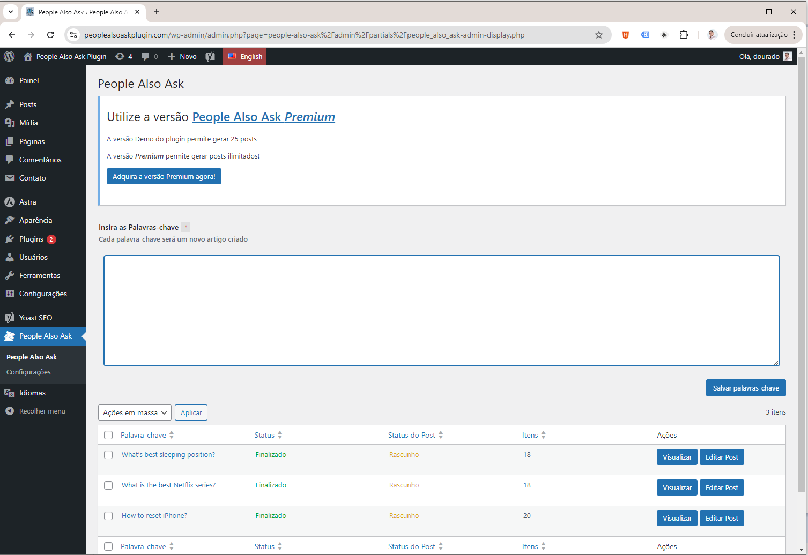 | 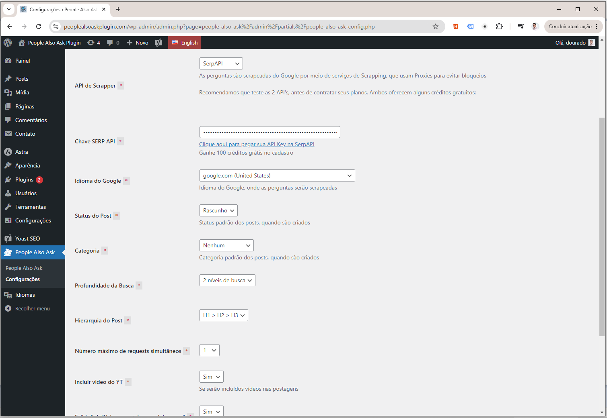 | 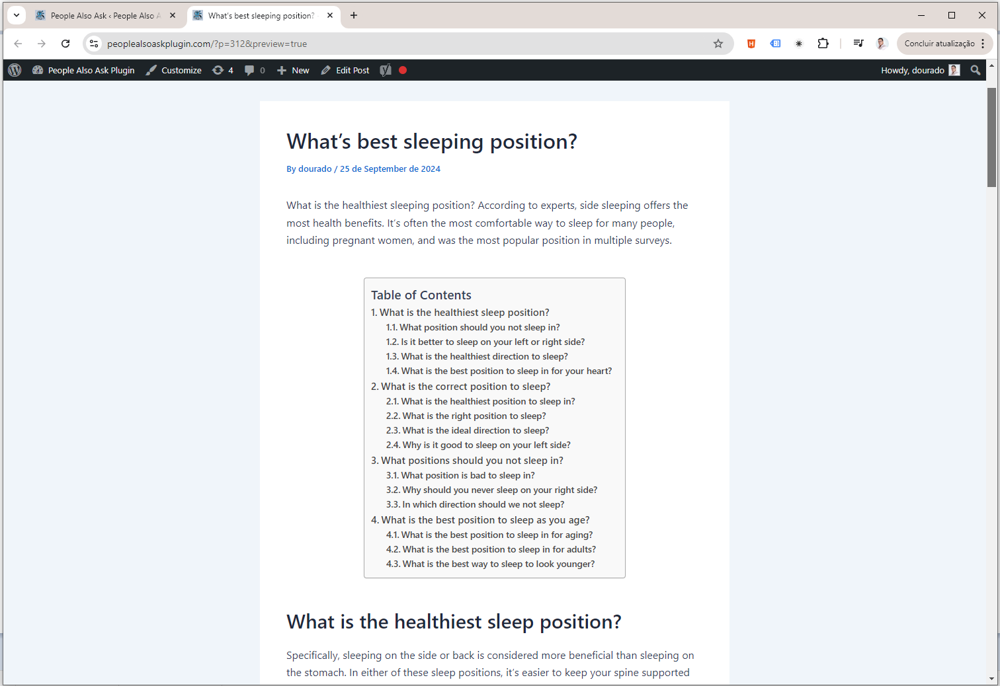 |

---

## Keynotes & Talks

### [Congresso E-Commerce Brasil Ads & Performance 2019](https://caiquedourado.com.br/congresso-e-commerce-brasil-adsperformance-2019-google-analytics-como-estruturar-quais-indicadores-medir-e-que-decisoes-tomar-partir-deles/)
*Google Analytics: Como estruturar, quais indicadores medir e que decisões tomar a partir deles?*

Keynote delivered to hundreds of e-commerce leaders on web analytics architecture, metric structuring, conversion funnels, and data-driven decision making.

[](https://www.youtube.com/watch?v=ubBikpBRV68)

---

## Recognition

- 🏆 **[E-Commerce Brasil Award 2019](https://caiquedourado.com.br/premio-e-commerce-brasil-profissional-destaque-do-ano-de-2019/):** Professional of the Year, Sales Category
- 🎤 **Speaker** at E-Commerce Brasil Ads & Performance Congress 2019 (Google Analytics)
- 🏅 **e-Bit Diamond Seal:** Editora Juspodivm (top 3 in Brazilian book segment)
- ⭐ **RA1000** by Reclame Aqui (Cupons VIP + Juspodivm)
- 🤝 **Advisory Board Member** at ABLEC (Brazilian E-Commerce Retailers Association, 2019-2022)
- 📚 **Member** of Academia E-Commerce Brasil (2020)

---

## Education & Certifications

- Growth Leaders Academy: Growth Hacking (2021)
- FIB: Computer Science / Systems Analysis (2007)
- Google Analytics · Google AdWords (Search & Shopping) · SEMrush Academy · e-Millennium ERP

---

## Beyond Code

When not architecting pipelines or analyzing data, I play electric bass. I run a YouTube channel with over 100 recorded bass covers: [youtube.com/@CaiqueDourado](https://www.youtube.com/@CaiqueDourado/videos).

[](https://www.youtube.com/watch?v=OMJANZzKwzU)

| | |
|:---:|:---:|
|  | 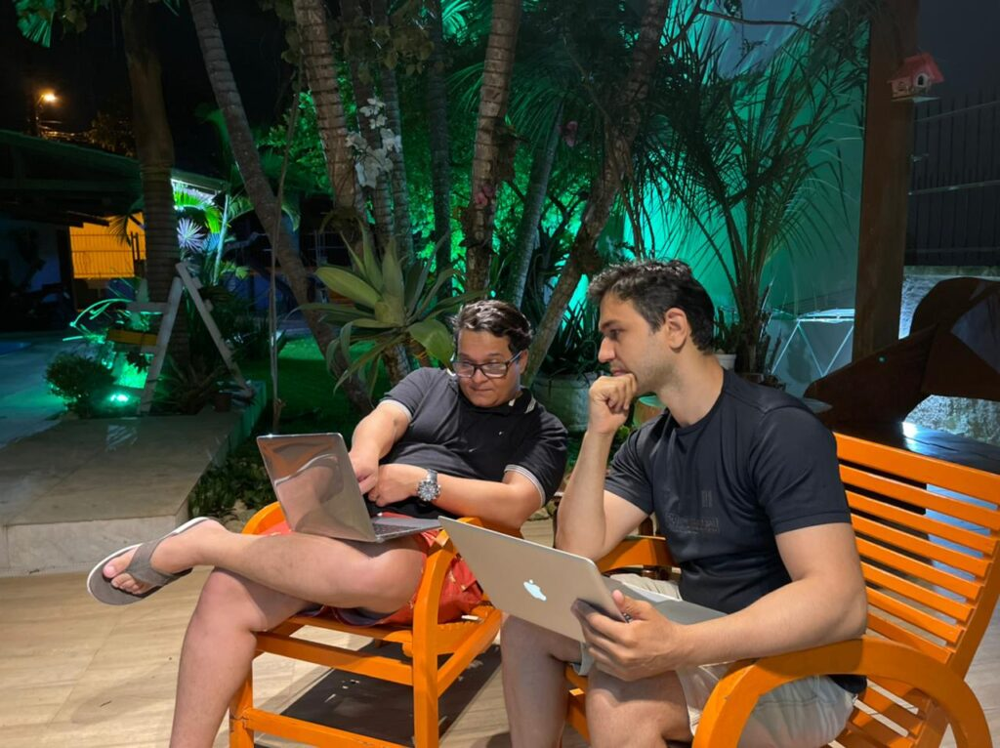 |

---

## Let's connect

- 🌐 [tudosobreprodutos.com.br](https://www.tudosobreprodutos.com.br)
- 💼 [linkedin.com/in/caiquedourado](https://www.linkedin.com/in/caiquedourado/)
- 📊 [kaggle.com/caiquedourado](https://www.kaggle.com/caiquedourado)
- ✉️ [contato@tudosobreprodutos.com.br](mailto:contato@tudosobreprodutos.com.br)
- 🐦 [@caiquedourado](https://twitter.com/caiquedourado)
- 📝 [caiquedourado.com.br](https://caiquedourado.com.br)

<sub>Software engineer, entrepreneur, bassist, and voracious reader. Mining web data and turning chaos into structure since 2001.</sub>

---

<details>
<summary>🇧🇷 Versão em Português (clique para expandir)</summary>

# Caique Dourado

### Engenheiro de Software · Engenheiro de Dados · Growth Hacker · Empreendedor

Construindo sistemas que transformam caos em decisão desde 2001.

Fundador do [TudoSobreProdutos.com.br](https://www.tudosobreprodutos.com.br) e [SuperNichos](https://supernichos.com). Head de Operações na [Agência Disco](https://www.disco-tec.com) (uma das principais agências Shopify do Brasil). Ex-CMO na Samurai Experts / Locaweb. Conselheiro da ABLEC. Mais de 25 anos de experiência prática, de Delphi 5 em 2001 a pipelines distribuídos de IA em 2026.

**Python · Next.js · C# · PostgreSQL · Redis · Google BigQuery · n8n**

🇧🇷 Remoto de Salvador, Bahia, Brasil

---

## O que eu faço

Construo sistemas autônomos que descobrem, ingerem, normalizam e interpretam volumes massivos de dados desestruturados da web, transformando ruído em inteligência de compra e decisões de negócio.

- **Crawlers Distribuídos & Pipelines de Dados:** Infraestrutura resiliente de raspagem (Playwright, DrissionPage, curl_cffi, Scrapy, httpx) com rotação inteligente de proxies e mitigação antibot em 3.600+ lojas.
- **Engenharia de Dados & Deduplicação:** Clusterização de catálogos entre múltiplos lojistas sem EAN/SKU usando Metaphone, Soundex, N-gram, MinHash e Perceptual Image Hashing.
- **IA, LLMs & NLP em Escala:** Extração de sentimento em milhões de reviews, pipelines de RAG, orquestração multi-provedor (OpenAI, Gemini, Claude), transcrição com Whisper, automação para YouTube e TTS neural.
- **SEO Programático / AEO / GEO:** Geração de conteúdo em escala orientada a dados (30M+ de páginas); dados estruturados, schema markup, SEO técnico e Core Web Vitals. Otimização para motores de resposta (Perplexity, ChatGPT Search) e Generative Engine Optimization para posicionar o conteúdo como fonte canônica para respostas geradas por IA.
- **Growth para E-commerce & CRO:** Testes A/B (GrowthBook, Optimizely), automação de CRM (Klaviyo, Insider), GA4, rastreamento server-side e otimização de funil de conversão.
- **Web Moderna de Alta Performance:** Next.js (SSR/SSG, TypeScript) + backends assíncronos em Python (FastAPI, Redis, Supabase/PostgreSQL, BigQuery).

---

## Projetos em destaque

### [TudoSobreProdutos.com.br](https://www.tudosobreprodutos.com.br) (Motor de inteligência de produtos, 2020 / relançado em 2026)
O equivalente brasileiro do RTINGS.com e Versus.com, com cobertura de preços do varejo brasileiro, 3.600+ lojas e certificações nacionais (INMETRO, ANVISA). Marcas não pagam por posição no ranking.
- Plataforma completa de Data Mining & IA Generativa com **pipeline ETL de 17 estágios**, da raspagem bruta à distribuição multimodal
- 2,8M+ de avaliações reais de usuários processadas; catálogo monitorado em 3.600+ lojas brasileiras
- **Metodologia de avaliação:** Processo em 4 etapas: triagem técnica (fabricantes + dados globais) → Big Data (cruzamento de milhares de reviews reais e transcrições de vídeos de especialistas) → Motor de IA (identificação de falhas crônicas e qualidades reais ignoradas por outros sites) → Curadoria humana (especialistas validam cada dado no contexto de uso); 3 pilares de rigor: prova social consolidada, métricas de durabilidade a longo prazo (não apenas performance recém-saído da caixa) e comparabilidade técnica normalizada por faixa de preço
- Pipeline proprietário de deduplicação para match de produtos entre lojistas sem EAN/SKU
- Sistema editorial **Human-in-the-Loop (HITL)**: IA gera, humanos validam, plataforma publica
- **LLM Ops** (`tiktoken`): gestão de contexto longo (100k+ tokens), chunking, otimização de custos e mitigação de alucinações
- **Pipeline de vídeo automatizado** (`Remotion`, `moviepy`, `edge-tts`): roteiros gerados por LLM alimentam composições do `Remotion` com narração TTS neural, publicados no YouTube Shorts e TikTok
- **Frontend:** Next.js 16 App Router + ISR (TTFB ~80-150ms no cache hit); cache em 3 camadas (`React cache()` + `unstable_cache` + Upstash Redis); deploy na Vercel Edge CDN; `shadcn/ui` + Radix UI
- **Observabilidade:** Sentry (erros em runtime), Vercel Analytics, Speed Insights (Core Web Vitals em produção)
- **Arquitetura agent-ready:** `llms.txt`, MCP Server Card, catálogo ARD 1.0, `agent-skills.json`; negociação de conteúdo `Accept: text/markdown` via pipeline `turndown` (HTML para Markdown); geração de imagens OG server-side via `@napi-rs/canvas`
- **AEO / GEO:** Pipeline proprietário de 12 etapas de conversão de HTML para Markdown (`lib/markdown-for-agents.ts`) que remove mais de 95% do ruído de interface das páginas Next.js para consumo por LLMs (1,55 MB de HTML reduzidos para 64 KB de Markdown, 86 imagens deduplicadas para 8); diretivas `Content-Signal` no `robots.txt` (`ai-train=no, search=yes`); injeção de cabeçalho de atribuição canônica em todas as respostas Markdown
- **Código aberto deste pipeline:** [scrapladder](https://github.com/CaiqueDourado/scrapladder) · [transcriptladder](https://github.com/CaiqueDourado/transcriptladder) · [llm-cost-kit](https://github.com/CaiqueDourado/llm-cost-kit) · [llm-batch-kit](https://github.com/CaiqueDourado/llm-batch-kit) · [pros-e-contras-ptbr](https://github.com/CaiqueDourado/pros-e-contras-ptbr) · [DedupKit](https://github.com/CaiqueDourado/DedupKit)

**Fluxo do sistema:**


**Exemplos reais:**

| Tipo | URL |
|:---|:---|
| Página de produto | [Apple AirPods Pro 3](https://www.tudosobreprodutos.com.br/fones-de-ouvido/apple-airpods-pro-3) |
| Comparação | [AirPods Pro 2 vs AirPods Pro 3](https://www.tudosobreprodutos.com.br/fones-de-ouvido/comparacoes/apple-airpods-pro-2-x-apple-airpods-pro-3) |
| Ranking Top 10 | [Top 4 Melhores Fones Apple](https://www.tudosobreprodutos.com.br/fones-de-ouvido/melhores/top-4-fones-de-ouvido-apple-qual-vale-mais-a-pena) |
| Artigo | [Assinaturas Sonoras: U-shape vs V-shape vs Neutro](https://www.tudosobreprodutos.com.br/fones-de-ouvido/artigos/assinaturas-sonoras-explicadas-u-shape-vs-v-shape-vs-neutro) |

**Vídeos gerados pelo pipeline do Remotion:**

| | |
|:---:|:---:|
| [](https://www.youtube.com/watch?v=zbM5CcOTwac) | [](https://www.youtube.com/watch?v=5rFta5DY1KI) |

**Website www.tudosobreprodutos.com.br:**


---

### [scrapladder](https://github.com/CaiqueDourado/scrapladder)
*Baixa páginas web subindo uma escada progressiva de métodos, lembrando por domínio qual degrau funcionou.*

[](https://github.com/CaiqueDourado/scrapladder)

Sobe uma escada progressiva de camadas de requisição — de HTTP simples (`requests`, `httpx`), personificação TLS de navegador real (`curl_cffi`), navegadores headless (Playwright, Camoufox, Scrapling), até APIs de scraping pagas — lembrando qual degrau teve sucesso por domínio e pulando degraus bloqueados automaticamente.

```python
from scrapladder import Ladder

with Ladder(memory="scrapladder.json") as ladder:
    r = ladder.fetch("https://loja.example.com.br/produto/123", must_contain="KZ ZSN Pro")

if r.ok:
    print(r.method, len(r.html))   # ex: curl_cffi 184213
else:
    print(r.summary())             # ex: blocked via - [curl_cffi:challenged > playwright:challenged]
```

[](https://github.com/CaiqueDourado/scrapladder)
[](https://github.com/CaiqueDourado/scrapladder)
[](https://github.com/CaiqueDourado/scrapladder/blob/main/LICENSE)

---

### [transcriptladder](https://github.com/CaiqueDourado/transcriptladder)
*Transcrições resilientes do YouTube que não quebram: legendas diretas, metadados do yt-dlp e fallback neural com Whisper.*

[](https://github.com/CaiqueDourado/transcriptladder)

Tenta a extração de legendas em ordem de resiliência em cascata (`youtube-transcript-api` → download direto da URL de legendas → extração de legendas via `yt-dlp` → `faster-whisper` local), adaptando-se dinamicamente conforme o YouTube atualiza suas páginas.

```python
from transcriptladder import Transcriber

with Transcriber(languages=["pt", "en"], memory="transcriptladder.json") as t:
    r = t.transcribe("https://youtu.be/VIDEO_ID")

if r.ok:
    print(r.method, r.language)      # ex: yt_dlp_subs pt
    print(r.text[:300])
    open("video.srt", "w").write(r.srt())
```

[](https://github.com/CaiqueDourado/transcriptladder)
[](https://github.com/CaiqueDourado/transcriptladder)
[](https://github.com/CaiqueDourado/transcriptladder/blob/main/LICENSE)
---

### [llm-cost-kit](https://github.com/CaiqueDourado/llm-cost-kit)
*Saiba quanto cada chamada de LLM custou de verdade, com preços rastreáveis até a página do provedor.*

[](https://github.com/CaiqueDourado/llm-cost-kit)

Rastreia o custo real de cada chamada de LLM — tokens de prompt, em cache, de saída e de pensamento (thinking) — em OpenAI, Gemini, Claude e DeepSeek, com tabelas de preços com fonte verificável. Nascido de uma auditoria real que reduziu a fatura de IA de um produto de US$ 1,00 para US$ 0,14 (−85,8%).

```python
from llm_cost_kit import Ledger, PriceTable, SQLiteSink, target, timer

prices = PriceTable.load("prices.yaml")   # todo preço tem source e checked_at
ledger = Ledger(prices, SQLiteSink("costs.sqlite"))

for product in products:
    with target(product_id=product["id"]):
        with timer() as t:
            resp = client.models.generate_content(model="gemini-2.5-flash", contents=prompt)
        ledger.record(resp, model="gemini-2.5-flash", flow="spec_sheet", latency_ms=t.ms)
```

```bash
$ llm-cost-kit report costs.sqlite --by meta.product_id
$ llm-cost-kit prices prices.yaml        # preços desatualizados ou suspeitos
$ llm-cost-kit check src/ --recorder record   # scripts chamando LLMs sem tarifação
```

[](https://github.com/CaiqueDourado/llm-cost-kit)
[](https://github.com/CaiqueDourado/llm-cost-kit)
[](https://github.com/CaiqueDourado/llm-cost-kit/blob/main/LICENSE)

---

### [SimilarImageFinder](https://github.com/CaiqueDourado/SimilarImageFinder)
*Encontre fotos de produto duplicadas ou quase duplicadas com hash perceptual de imagens — Python e .NET devolvem os mesmos bits.*

[](https://github.com/CaiqueDourado/SimilarImageFinder)

Hash perceptual de imagens (aHash, dHash, pHash) para identificar imagens quase duplicadas mesmo após redimensionamento, recompressão ou ajustes de brilho. Criado a partir da experiência de 5 anos gerenciando 114 milhões de ofertas de produtos de 7.179 lojas brasileiras — onde a mesma foto de lojistas diferentes nunca compartilhava o mesmo SHA-256.

```python
from similar_image_finder import perceptual_hash

a = perceptual_hash("loja-a/luminaria.jpg")
b = perceptual_hash("loja-b/pendente-preto-600x600.webp")
print(a - b)   # Distância de Hamming: 0-6 = mesma imagem, >20 = produto diferente
```

```csharp
using SimilarImageFinder;

var a = ImageLoader.Hash("loja-a/luminaria.jpg");          // pHash, 64 bits
var b = ImageLoader.Hash("loja-b/pendente.webp");
Console.WriteLine(a - b);                                // Distância de Hamming
```

[](https://github.com/CaiqueDourado/SimilarImageFinder)
[](https://github.com/CaiqueDourado/SimilarImageFinder)
[](https://github.com/CaiqueDourado/SimilarImageFinder)
[](https://github.com/CaiqueDourado/SimilarImageFinder/blob/main/LICENSE)

---

### Bibliotecas Open Source & Ferramentas para Desenvolvedores

<table>
<tr>
  <td width="72" align="center">
    <a href="https://github.com/CaiqueDourado/scrapladder"></a>
  </td>
  <td>
    <a href="https://github.com/CaiqueDourado/scrapladder"><b>scrapladder</b></a>: Baixa páginas web subindo uma escada progressiva de métodos (HTTP simples, personificação TLS com curl_cffi, Playwright, APIs pagas) e lembra por domínio qual degrau funcionou.<br>
    <a href="https://github.com/CaiqueDourado/scrapladder"></a>
    
  </td>
</tr>
<tr>
  <td width="72" align="center">
    <a href="https://github.com/CaiqueDourado/transcriptladder"></a>
  </td>
  <td>
    <a href="https://github.com/CaiqueDourado/transcriptladder"><b>transcriptladder</b></a>: Transcrição resiliente de vídeos do YouTube combinando APIs de legendas, metadados do yt-dlp e fallback neural com faster-whisper. Gera texto limpo, segmentos cronometrados e SRT.<br>
    <a href="https://github.com/CaiqueDourado/transcriptladder"></a>
    
  </td>
</tr>
<tr>
  <td width="72" align="center">
    <a href="https://github.com/CaiqueDourado/DedupKit"></a>
  </td>
  <td>
    <a href="https://github.com/CaiqueDourado/DedupKit"><b>DedupKit</b></a>: Deduplicação de produtos entre múltiplos lojistas para o e-commerce brasileiro. Identifica ofertas idênticas sem EAN/SKU e rejeita falsos positivos (Python e .NET com resultados idênticos).<br>
    <a href="https://github.com/CaiqueDourado/DedupKit"></a>
    
  </td>
</tr>
<tr>
  <td width="72" align="center">
    <a href="https://github.com/CaiqueDourado/search-pattern-miner"></a>
  </td>
  <td>
    <a href="https://github.com/CaiqueDourado/search-pattern-miner"><b>search-pattern-miner</b></a>: Transforma buscas em modelos de página (<code>como fazer [comida]</code>) com os 7 algoritmos por trás do SuperNichos: prefixos, n-gramas, skip-grams, saco de palavras e troca de entidades, mais ranking por volume e CPC (Python e .NET com resultados idênticos).<br>
    <a href="https://github.com/CaiqueDourado/search-pattern-miner"></a>
    
  </td>
</tr>
<tr>
  <td width="72" align="center">
    <a href="https://github.com/CaiqueDourado/llm-cost-kit"></a>
  </td>
  <td>
    <a href="https://github.com/CaiqueDourado/llm-cost-kit"><b>llm-cost-kit</b></a>: Calcula custos exatos e precificação de tokens para chamadas de inferência de LLM em OpenAI, Anthropic Claude, Google Gemini e modelos abertos com fontes atualizadas.<br>
    <a href="https://github.com/CaiqueDourado/llm-cost-kit"></a>
    
  </td>
</tr>
<tr>
  <td width="72" align="center">
    <a href="https://github.com/CaiqueDourado/llm-batch-kit"></a>
  </td>
  <td>
    <a href="https://github.com/CaiqueDourado/llm-batch-kit"><b>llm-batch-kit</b></a>: APIs de lote do provedor pela metade do preço, sem resposta trocada nem pagar duas vezes: pares (prompt, item), manifesto assinado, coleta idempotente e fila no Postgres.<br>
    <a href="https://github.com/CaiqueDourado/llm-batch-kit"></a>
    
  </td>
</tr>
<tr>
  <td width="72" align="center">
    <a href="https://github.com/CaiqueDourado/SimilarImageFinder"></a>
  </td>
  <td>
    <a href="https://github.com/CaiqueDourado/SimilarImageFinder"><b>SimilarImageFinder</b></a>: Motor de hash perceptual de imagens (aHash, dHash, pHash, wHash) para deduplicação em grande escala de fotos de produtos e clusterização de catálogos de e-commerce.<br>
    <a href="https://github.com/CaiqueDourado/SimilarImageFinder"></a>
  </td>
</tr>
<tr>
  <td width="72" align="center">
    <a href="https://github.com/CaiqueDourado/BrCommerceKit"></a>
  </td>
  <td>
    <a href="https://github.com/CaiqueDourado/BrCommerceKit"><b>BrCommerceKit</b></a>: Toolkit de engenharia de e-commerce brasileiro para .NET / C#. Identificação de 20 plataformas (Shopify, VTEX, Nuvemshop, Loja Integrada), leitor streaming de feeds com dialetos brasileiros (<code>preco_por</code>, <code>g:</code>), leitor de <code>products.json</code> da Shopify, normalizador de preços em BRL e inspetor de qualidade de catálogo (placeholder e EANs genéricos).<br>
    <a href="https://github.com/CaiqueDourado/BrCommerceKit"></a>
    
    
  </td>
</tr>
<tr>
  <td width="72" align="center">
    <a href="https://github.com/CaiqueDourado/PtBr.Text"></a>
  </td>
  <td>
    <a href="https://github.com/CaiqueDourado/PtBr.Text"><b>PtBr.Text</b></a>: Toolkit de texto e dados em português brasileiro para .NET. Validação e formatação de CPF, novo CNPJ alfanumérico, CEP e telefones de 9 dígitos. Geração de texto com concordância de gênero/plural, extração RAKE PT-BR de palavras-chave e extração de contatos.<br>
    <a href="https://github.com/CaiqueDourado/PtBr.Text"></a>
    
    
  </td>
</tr>
<tr>
  <td width="72" align="center">
    <a href="https://github.com/CaiqueDourado/pros-e-contras-ptbr"></a>
  </td>
  <td>
    <a href="https://github.com/CaiqueDourado/pros-e-contras-ptbr"><b>pros-e-contras-ptbr</b></a>: Principais prós e contras de um produto a partir de avaliações em português brasileiro. Sem API, sem download de modelos; léxico aprendido a partir de 11,7 milhões de cláusulas de reviews reais.<br>
    <a href="https://github.com/CaiqueDourado/pros-e-contras-ptbr"></a>
    
    
  </td>
</tr>
<tr>
  <td width="72" align="center">
    <a href="https://github.com/CaiqueDourado/DomainCheck"></a>
  </td>
  <td>
    <a href="https://github.com/CaiqueDourado/DomainCheck"><b>DomainCheck</b></a>: Esse domínio está disponível? Consulta ao Registro.br para <code>.br</code>, WHOIS descoberto via IANA para qualquer outra extensão, pré-checagem via DNS e gerador de nomes candidatos.<br>
    <a href="https://github.com/CaiqueDourado/DomainCheck"></a>
    
    
  </td>
</tr>
<tr>
  <td width="72" align="center">
    <a href="https://github.com/CaiqueDourado/ibge-nomes"></a>
  </td>
  <td>
    <a href="https://github.com/CaiqueDourado/ibge-nomes"><b>ibge-nomes</b></a>: Cliente Python para a API de nomes do IBGE (Censo 2010): posição no ranking, frequência, estado de maior incidência, sexo e década de nascimento. Apenas biblioteca padrão.<br>
    <a href="https://github.com/CaiqueDourado/ibge-nomes"></a>
    
    
  </td>
</tr>
<tr>
  <td width="72" align="center">
    <a href="https://br.wordpress.org/plugins/people-also-ask/"></a>
  </td>
  <td>
    <a href="https://br.wordpress.org/plugins/people-also-ask/"><b>People Also Ask Plugin</b></a>: Plugin oficial para WordPress.org automatizando a criação de conteúdo para SEO programático com base nas perguntas "As pessoas também perguntam" da SERP do Google. Raspagem multinível, Schema Markup automatizado e embeds do YouTube.<br>
    <a href="https://br.wordpress.org/plugins/people-also-ask/"></a>
    <a href="https://www.youtube.com/watch?v=txbozF2zYZA"></a>
    
  </td>
</tr>
<tr>
  <td width="72" align="center">
    <a href="https://supernichos.com"></a>
  </td>
  <td>
    <a href="https://supernichos.com"><b>SuperNichos</b></a>: Maior motor de descoberta de nichos e mineração de segmentos do Brasil. Ingestão de 50M de buscas do Google Brasil, normalizando e agrupando termos com Metaphone, Soundex, MinHash e N-gram.<br>
    <a href="https://supernichos.com"></a>
    <a href="https://www.youtube.com/watch?v=kR3OM_zQE30&t=385s"></a>
    
  </td>
</tr>
</table>

---

### Datasets Abertos & Destaques de Escala

| | Repositório / Dataset | Volume / Escala | Foco & Descrição |
| :---: | :--- | :--- | :--- |
| <a href="https://github.com/CaiqueDourado/google-keywords-dataset"></a> | [**google-keywords-dataset**](https://github.com/CaiqueDourado/google-keywords-dataset) · [Kaggle](https://www.kaggle.com/datasets/caiquedourado/google-keywords-dataset) | **38 mi de buscas**, 1,73 mi de padrões, 138 mi de pares padrão → busca | Palavras-chave do Google com volume, CPC e concorrência (Brasil, EUA, Espanha, Argentina), padrões de busca de cinco algoritmos e rótulos de curadoria feitos à mão; os dados por trás do SuperNichos. |
| <a href="https://github.com/CaiqueDourado/brazilian-ecommerce-products"></a> | [**brazilian-ecommerce-products**](https://github.com/CaiqueDourado/brazilian-ecommerce-products) · [Kaggle](https://www.kaggle.com/datasets/caiquedourado/catalogo-produtos-ecommerce-brasil) | **114M de ofertas** (7.179 lojas) | Catálogo aberto massivo de preços e ofertas de produtos do e-commerce brasileiro. |
| <a href="https://github.com/CaiqueDourado/portuguese-product-reviews"></a> | [**portuguese-product-reviews**](https://github.com/CaiqueDourado/portuguese-product-reviews) · [Kaggle](https://www.kaggle.com/datasets/caiquedourado/reviews-produtos-ptbr) | **2,87M de avaliações** | Base de dados de avaliações de produtos no Brasil com classificação de sentimento e extração de prós e contras. |
| <a href="https://github.com/CaiqueDourado/product-matching-pairs-portuguese"></a> | [**product-matching-pairs-portuguese**](https://github.com/CaiqueDourado/product-matching-pairs-portuguese) · [Kaggle](https://www.kaggle.com/datasets/caiquedourado/pares-matching-produtos-ptbr) | **2,1M de pares rotulados** | Dataset de benchmark com pares de ofertas de produtos rotulados para validação de deduplicação e fuzzy match. |
| <a href="https://github.com/CaiqueDourado/lojas-virtuais-brasil"></a> | [**lojas-virtuais-brasil**](https://github.com/CaiqueDourado/lojas-virtuais-brasil) · [Kaggle](https://www.kaggle.com/datasets/caiquedourado/lojas-virtuais-brasil) | **63.974 lojas** | Censo de lojas virtuais brasileiras com fingerprint de plataforma, verificação de SSL e dados cadastrais de CNPJ. |
| <a href="https://github.com/CaiqueDourado/fipe-ficha-tecnica-veiculos"></a> | [**fipe-ficha-tecnica-veiculos**](https://github.com/CaiqueDourado/fipe-ficha-tecnica-veiculos) · [Kaggle](https://www.kaggle.com/datasets/caiquedourado/fipe-ficha-tecnica-veiculos) | **1,65M de preços FIPE**, 37.794 versões, 25,5M de pares com autopeças | Preços de veículos no Brasil de 2020 a 2026 (carros, motos, caminhões), fichas técnicas e cruzamento veículo × autopeças. |
| <a href="https://github.com/CaiqueDourado/brazilian-names-surnames"></a> | [**brazilian-names-surnames**](https://github.com/CaiqueDourado/brazilian-names-surnames) · [Kaggle](https://www.kaggle.com/datasets/caiquedourado/nomes-e-sobrenomes-brasil) | **46.840 nomes, 27.047 sobrenomes** | Nomes e sobrenomes brasileiros com frequências do Censo do IBGE, chaves fonéticas e significados. |
| <a href="https://github.com/CaiqueDourado/municipios-e-estados-do-brasil"></a> | [**municipios-e-estados-do-brasil**](https://github.com/CaiqueDourado/municipios-e-estados-do-brasil) · [Kaggle](https://www.kaggle.com/datasets/caiquedourado/municipios-e-estados-do-brasil) | **5.570 municípios** | Todos os 5.570 municípios brasileiros, 27 estados, códigos do IBGE e metadados geográficos. |
| <a href="https://github.com/CaiqueDourado/palavras-da-biblia"></a> | [**palavras-da-biblia**](https://github.com/CaiqueDourado/palavras-da-biblia) · [Kaggle](https://www.kaggle.com/datasets/caiquedourado/palavras-da-biblia) | **592.643 palavras**, 30.127 diferentes | Frequência das palavras da Bíblia (Almeida 1993) por livro e Testamento, palavras características e trechos citados. |
| <a href="https://github.com/CaiqueDourado/dicionario-portugues"></a> | [**dicionario-portugues**](https://github.com/CaiqueDourado/dicionario-portugues) · [Kaggle](https://www.kaggle.com/datasets/caiquedourado/dicionario-portugues) | **272 mil palavras**, 2,9 mi textos de IA, 2,3 mi rimas | Lista de palavras do português com chaves fonéticas, radicais, frequência e rimas, mais significado, sinônimos e gramática escritos por GPT-3.5 e davinci (sem revisão); os dados por trás do Tudo sobre as Palavras. |
| <a href="https://github.com/CaiqueDourado/portuguese-entity-gazetteer"></a> | [**portuguese-entity-gazetteer**](https://github.com/CaiqueDourado/portuguese-entity-gazetteer) · [Kaggle](https://www.kaggle.com/datasets/caiquedourado/portuguese-entity-gazetteer) | **307 mil entidades**, 747 tipos, 26 classes | Dicionário de entidades do português (lugares, pessoas, obras, produtos e marcas) com seus tipos, revisado à mão; o dicionário de entidades dos padrões de busca do SuperNichos. |
| <a href="https://github.com/CaiqueDourado/brazilian-notary-registry-offices"></a> | [**brazilian-notary-registry-offices**](https://github.com/CaiqueDourado/brazilian-notary-registry-offices) · [Kaggle](https://www.kaggle.com/datasets/caiquedourado/brazilian-notary-registry-offices) | **16.266 serventias**, amostra de 1.009 com arrecadação 2005–2026 | Cartórios do Brasil a partir do cadastro do CNJ: atribuições, atos e arrecadação por semestre, decisões da Corregedoria; dados pessoais mascarados. |
| <a href="https://github.com/CaiqueDourado/paises-do-mundo-ptbr"></a> | [**paises-do-mundo-ptbr**](https://github.com/CaiqueDourado/paises-do-mundo-ptbr) · [Kaggle](https://www.kaggle.com/datasets/caiquedourado/paises-do-mundo-ptbr) | **167 países**, 53 colunas | Códigos ISO, nomes em português do Brasil, idiomas, moedas, fusos horários e formatos regionais. |
| <a href="https://github.com/CaiqueDourado/taxonomia-google-produtos-ptbr"></a> | [**taxonomia-google-produtos-ptbr**](https://github.com/CaiqueDourado/taxonomia-google-produtos-ptbr) · [Kaggle](https://www.kaggle.com/datasets/caiquedourado/taxonomia-google-produtos-ptbr) | **5.595 categorias** | A taxonomia de produtos do Google em português e inglês: tabela, tabela de fechamento e árvore JSON. |

---

### [SuperNichos](https://supernichos.com) (Mineração de nichos e palavras-chave, 2023-atual)
- 700.000 nichos e 50M+ de palavras-chave em uma única plataforma
- Maior ferramenta de descoberta de nichos e mineração de segmentos do Brasil
- **A história de origem:** [O que aprendi debulhando 50 milhões de termos de busca no Google](https://caiquedourado.com.br/o-que-aprendi-debulhando-50-milhoes-de-termos-de-busca-no-google/) (2023): a planilha que virou a ferramenta

**Como foi construído:**
1. **Ingestão de Dados:** Processamento de 55 milhões de buscas do Google com volume, CPC e concorrência (métricas do Keyword Planner via Ubersuggest em 2018, mais DataForSEO para Brasil, EUA, Espanha e Argentina).
2. **Normalização & Clusterização:** Normalização dos termos de busca e agrupamento para identificar padrões semânticos e textuais usando algoritmos de similaridade de strings (Metaphone, Soundex, N-gram, MinHash, Fingerprint, NgramKeyer).
3. **Mineração & Descoberta:** Clusterização final para revelar milhares de nichos lucrativos e oportunidades de mercado (para criação de produtos, serviços, atendimento de dores latentes e SEO programático).

- **Dados e código abertos:** [google-keywords-dataset](https://github.com/CaiqueDourado/google-keywords-dataset) (38 mi de buscas, 1,73 mi de padrões de cinco algoritmos, 154 mil padrões rotulados à mão) · [search-pattern-miner](https://github.com/CaiqueDourado/search-pattern-miner) (os algoritmos, reescritos em Python e .NET) · [portuguese-entity-gazetteer](https://github.com/CaiqueDourado/portuguese-entity-gazetteer) (o dicionário de 307 mil entidades dos padrões com [tipo]) · artigo: [Sete jeitos de transformar milhões de buscas do Google em modelos de página](https://github.com/CaiqueDourado/articles/blob/main/seven-ways-search-patterns/README.pt-BR.md)

[](https://www.youtube.com/watch?v=kR3OM_zQE30&t=385s)

### [Gambis Mode [On]](https://caiquedourado.com.br) (Laboratório Independente: SEO Programático & Data Mining, 2017-atual)
Laboratório independente de engenharia de software e SEO programático responsável pela concepção, implementação e monetização de **mais de 40 plataformas web em produção**.
- **Escala:** Mais de 30 milhões de páginas indexadas geradas a partir de bases abertas massivas (Apple Enterprise Partner Feed, DBpedia, Freebase, IMDB, MusicBrainz, MovieLens, Open Food Facts, Tabela FIPE, CNPJs da Receita Federal, CEPs dos Correios, Frases, Bíblia)
- **Engenharia de Dados & NLP:** Deduplicação de entidades com OpenRefine, algoritmos fonéticos e de similaridade de strings (Metaphone, Soundex, N-gram, MinHash) e parsing sintático via Stanford NLP (POS Tagger)
- **Infraestrutura & Automação:** Scrapers distribuídos com múltiplos proxies (Selenium, Chrome Headless, Cloudflare Workers, resolução de anti-captcha), renderização dinâmica de banners em C# (`System.Drawing.Image`) e hospedagem serverless no Google Cloud Storage
- **Monetização & Ecossistema AdTech:** Monetização comercial em larga escala via header bidding, ad exchanges e redes de afiliados (Google Ad Manager, Google AdSense, Awin, Lomadee, Rakuten Marketing, Amazon Associates, Taboola, Teads, MGID, Seedtag, Rubicon, RTB House, Cazamba, Clever Advertising)

### Agência Disco (Head de Operações, 2023-atual)
Operação de growth e e-commerce em Shopify para marcas como Chocolates Dengo, Rommanel, Malwee, CIMED, Garmin, Contém 1G, Bold Snacks, Tânia Bulhões e mais de 20 outras.
- Growth Marketing, CRO, SEO Programático, Testes A/B (GrowthBook)
- CRM e automação de marketing (Klaviyo, Insider, Shopify Email, n8n, Shopify Flow)
- GA4, rastreamento server-side, Customer Events, analytics & BI

### Samurai Experts / Locaweb (CMO & Growth, 2021-2023)
- Chief Marketing Officer, Growth Hacker
- Branding Manager na Wake (wake.tech)

### Editora Juspodivm (Head de E-commerce, 2014-2021, 7+ anos)
- Formação e liderança de equipe (de 1 para 8 pessoas); maior e-commerce do Norte/Nordeste
- Migração completa de ERP + plataforma de e-commerce (virada em um único dia em 2016)
- **Selo Diamante e-Bit** (uma das únicas 3 empresas no segmento de livros do Brasil)
- **RA1000** pelo Reclame Aqui
- Stack: Moovin, e-Millennium ERP, Konduto, SendGrid, Maxipago, AWS, Cloudflare, Criteo, Optimizely

| | | |
|:---:|:---:|:---:|
|  |  |  |

### [Google Analytics Real Time Dashboard](https://caiquedourado.com.br/dashboard-em-tempo-real-para-acompanhamento-seu-e-commerce/) (2017)
Dashboard de acompanhamento em tempo real para operações de e-commerce.
- Monitoramento de tráfego, conversão e canais de aquisição em tempo real
- Utilizado por mais de 5.000 lojas virtuais


### Cupons VIP (Co-fundador & CTO, 2011-2013)
Desenvolvido do zero em ASP.NET + SQL Server + Azure (9 meses de desenvolvimento, noites e finais de semana). Atuação como CTO e empreendedor em todas as frentes:
- **Desenvolvimento de Produto:** Arquitetura full stack (Frontend, Backend em ASP.NET e SQL Server)
- **Infraestrutura & Hospedagem:** Servidores e edge com Azure CDN e Cloudflare
- **Atendimento & Sucesso do Cliente:** Conquista do selo **RA1000** do Reclame Aqui
- **Entregabilidade de E-mail:** 99% de reputação de IP no SenderBase, SenderScore e SNDS da Microsoft
- **Disparos em Massa:** 2 milhões de e-mails/mês
- **Crescimento:** Em 1 ano e meio: de 0 para 140.000 visualizações/mês e ~40.000 clientes em Salvador, Fortaleza e Recife; parcerias formais com o portal iBahia e Microsoft Azure

| | |
|:---:|:---:|
|  |  |

### "Baralho do Crime" (2011, projeto viral para o Governo da Bahia)
- Projeto entregue da noite para o dia para a Secretaria de Segurança Pública da Bahia (Pacto pela Vida)
- 10.000 visitantes em um único dia; repercussão massiva na imprensa nacional
- Principais matérias:
  - [G1 / Globo: Segurança Pública da Bahia divulga Baralho do Crime](http://g1.globo.com/bahia/noticia/2011/06/seguranca-publica-da-bahia-divulga-baralho-do-crime.html)
  - [UOL Notícias: Governo da Bahia lança jogo na internet para deter criminosos](http://noticias.uol.com.br/ultimas-noticias/efe/2011/06/03/governo-da-bahia-lanca-jogo-na-internet-para-deter-criminosos.jhtm)

| | |
|:---:|:---:|
|  |  |

### Open Source & Publicações
- Artigos (2026): [De 1,7 milhão de padrões de busca a 83 sites: como escolhi o que construir](https://github.com/CaiqueDourado/articles/blob/main/choosing-sites/README.pt-BR.md) ([em inglês no Medium](https://medium.com/@caiquedourado/from-1-7-million-search-patterns-to-83-sites-how-i-chose-what-to-build-f764687dfe12)) · [Quase 400 milhões de padrões de busca, cinco bancos de dados e o que de fato funcionou](https://github.com/CaiqueDourado/articles/blob/main/scale-search-patterns/README.pt-BR.md) ([em inglês no Medium](https://medium.com/@caiquedourado/almost-400-million-search-patterns-five-databases-and-what-actually-worked-139cb4a28c4e)) · [Sete jeitos de transformar milhões de buscas do Google em modelos de página](https://github.com/CaiqueDourado/articles/blob/main/seven-ways-search-patterns/README.pt-BR.md) ([em inglês no Medium](https://medium.com/@caiquedourado/seven-ways-to-turn-millions-of-google-searches-into-page-templates-3671235eac0f)) · todos em [articles](https://github.com/CaiqueDourado/articles)
- Artigos de dados e NLP (2026): [Metaphone, Soundex, n-gramas e MinHash em nomes de produtos brasileiros](https://github.com/CaiqueDourado/articles/blob/main/text-similarity/README.pt-BR.md) · [Achando a mesma foto em 7.179 lojas](https://github.com/CaiqueDourado/articles/blob/main/image-similarity/README.pt-BR.md) · [Divisão de sentenças + análise de sentimentos = prós e contras](https://github.com/CaiqueDourado/articles/blob/main/pros-and-cons/README.pt-BR.md) · [Enriquecendo cadastros com APIs abertas](https://github.com/CaiqueDourado/articles/blob/main/open-apis/README.pt-BR.md) · [Treinando o Stanford NER em português com um dicionário](https://github.com/CaiqueDourado/articles/blob/main/stanford-ner/README.pt-BR.md) · [O que aprendi debulhando 50 milhões de buscas](https://github.com/CaiqueDourado/articles/blob/main/fifty-million-searches/README.pt-BR.md)
- Artigos antigos: *Guia de Push Notifications*

---

## Projetos de SEO Programático

Projetos desenvolvidos a partir de 2020 com foco em geração de milhões de páginas indexadas via rastreamento web, catalogação de dados, NLP e hospedagem serverless.

### [Tudo Sobre Produtos (1ª Versão)](https://web.archive.org/web/20251021032358/https://tudosobreprodutos.com.br/tudo-sobre-bebedouro-cadence-pure-vita-elegant-0v) (2020)
Guia de produtos com especificações detalhadas, opiniões de compradores e comparações.
- **Escala:** 280.000 produtos extraídos via feeds XML de 4.800 lojas brasileiras
- **Prova social:** 2.871.096 avaliações de usuários via API do Bazaarvoice
- **Web scraping:** Crawler de fichas técnicas nos sites dos fabricantes e lojas
- **Deduplicação:** Matching de títulos de produtos com Metaphone, Soundex, N-gram, MinHash e hash perceptual de imagens ([ImageHash](https://github.com/coenm/ImageHash))
- **NLP:** Geração de Prós e Contras via divisão de sentenças com POS Tagger + Análise de Sentimento no Amazon Comprehend ([ver apresentação da arquitetura](https://docs.google.com/presentation/d/1Y9ShmHLBnlbyZYIlbUPzZ_-QEk0fqIO6UMf-0dZOPQM/edit#slide=id.p))
- **Dados estruturados:** Schemas JSON-LD de FAQ, ItemList, Product, Table, BreadcrumbList e Article
- **Arquitetura:** 100% estático em HTML gerado em C# e SQL Server, hospedado no Google Cloud Storage (serverless)
- **Dados e código abertos:** [brazilian-ecommerce-products](https://github.com/CaiqueDourado/brazilian-ecommerce-products) · [portuguese-product-reviews](https://github.com/CaiqueDourado/portuguese-product-reviews) · [product-matching-pairs-portuguese](https://github.com/CaiqueDourado/product-matching-pairs-portuguese) · [DedupKit](https://github.com/CaiqueDourado/DedupKit) · [SimilarImageFinder](https://github.com/CaiqueDourado/SimilarImageFinder) · [pros-e-contras-ptbr](https://github.com/CaiqueDourado/pros-e-contras-ptbr)
- **Arquivo histórico:** [Conheça o site arquivado](https://web.archive.org/web/20251021032358/https://tudosobreprodutos.com.br/tudo-sobre-bebedouro-cadence-pure-vita-elegant-0v)


### Portal de Cartórios no Brasil (2024)
Guia nacional de cartórios com informações completas de todos os municípios brasileiros.
- **Escala:** Base com todos os cartórios de notas, registro civil e imóveis do Brasil
- **Arquitetura:** Uma página por serventia, gerada a partir das tabelas coletadas e publicada no WordPress, com mapas e dados estruturados locais
- **Audiência:** Milhares de acessos orgânicos/mês para emissão de certidões e serviços notariais
- **Dados e código abertos:** [brazilian-notary-registry-offices](https://github.com/CaiqueDourado/brazilian-notary-registry-offices) (amostra do cadastro coletado: atribuições, arrecadação desde 2005 e decisões do CNJ) · [Kaggle](https://www.kaggle.com/datasets/caiquedourado/brazilian-notary-registry-offices)

### [Nomes e Sobrenomes](https://web.archive.org/web/20250610174857/https://nomessobrenomes.com/qual-o-significado-do-nome-alan-gustavo) (2023)
Portal com 104 mil nomes próprios catalogados com significados, origem, etimologia e numerologia.
- **Escala:** 104 mil páginas geradas a partir de base de dados proprietária
- **Tecnologia:** Next.js 14, Tailwind CSS, TypeScript, Supabase e API da OpenAI
- **Performance:** 100% adequado a dispositivos móveis com notas perfeitas no Web Vitals
- **Dados estruturados:** Schemas JSON-LD de FAQ, ItemList, WebSite, Breadcrumbs e Article
- **Dados e código abertos:** [brazilian-names-surnames](https://github.com/CaiqueDourado/brazilian-names-surnames) · [ibge-nomes](https://github.com/CaiqueDourado/ibge-nomes)
- **Arquivo histórico:** [Conheça o site arquivado](https://web.archive.org/web/20250610174857/https://nomessobrenomes.com/qual-o-significado-do-nome-alan-gustavo)


### [Tudo Sobre Lojas](https://web.archive.org/web/20250618081809/https://tudosobrelojas.com/a-loja-saboreat-e-confavel-tudo-sobre-a-loja-saboreat/) (2023)
Análise completa de lojas virtuais e e-commerces brasileiros com dados enriquecidos de reputação e cadastro.
- **Escala:** Scraping e análise de 63.933 lojas brasileiras
- **Evidências visuais automáticas:** Geração de screenshots da página da loja no Reclame Aqui e da homepage da loja usando C# e Selenium
- **Enriquecimento cadastral:** Extração do CNPJ no Whois e cruzamento com a base de CNPJ da Receita Federal (sócios, razão social, nome fantasia, CNPJ, CNAE, capital social, endereço, e-mail, telefone)
- **Segurança & Reputação:** Checagem automatizada de certificado SSL e links diretos para busca de reclamações no Consumidor.gov.br, Jusbrasil e Reclame Aqui
- **Identificação de tecnologia:** Detecção automática da plataforma de e-commerce utilizada (Shopify, VTEX, WooCommerce, Nuvemshop, etc.)
- **IA:** Geração de conteúdo de apoio e síntese explicativa com API da OpenAI
- **Dados e código abertos:** [lojas-virtuais-brasil](https://github.com/CaiqueDourado/lojas-virtuais-brasil) · [BrCommerceKit](https://github.com/CaiqueDourado/BrCommerceKit) · [DomainCheck](https://github.com/CaiqueDourado/DomainCheck)
- **Arquivo histórico:** [Conheça o site arquivado](https://web.archive.org/web/20250618081809/https://tudosobrelojas.com/a-loja-saboreat-e-confavel-tudo-sobre-a-loja-saboreat/)


### [Tudo sobre as Palavras](https://web.archive.org/web/20250923215535/https://tudosobreaspalavras.com/tudo-sobre-a-palavra-arrogado) (2023)
Dicionário completo com 187 mil palavras, incluindo significados, sinônimos, gramática e exercícios educativos.
- **Escala:** 187 mil páginas geradas (uma para cada verbete) a partir de banco de dados pt-BR + geração de conteúdo com API da OpenAI
- **Riqueza gramatical:** Significado idiomático e regional, sinônimos, antônimos, ortografia e pronúncia, classe gramatical, consoantes, vogais, radical, separação silábica, sílaba tônica, singular/plural, flexão de gênero, tempos verbais (infinitivo, gerúndio, particípio), contagem de letras, atividades, jogos, rimas e exemplos práticos de uso
- **Imagens:** Geração programática de imagens e artes explicativas em C#
- **Arquitetura:** 100% em HTML estático gerado em C#, banco SQL Server e hospedado no Google Cloud Storage (serverless, escalabilidade infinita)
- **Performance:** 100% adequado a dispositivos móveis, pontuação máxima no Web Vitals e schemas JSON-LD
- **Arquivo histórico:** [Conheça o site arquivado](https://web.archive.org/web/20250923215535/https://tudosobreaspalavras.com/tudo-sobre-a-palavra-arrogado)
- **Dados e código abertos:** [dicionario-portugues](https://github.com/CaiqueDourado/dicionario-portugues) (272 mil palavras, 2,9 mi textos de IA com o modelo de cada um, 2,3 mi rimas)


### [Tudo Sobre Carros, Motos e Caminhões](https://web.archive.org/web/20230123215505/https://tudoparaseuscarros.com/) (2022)
Família de quatro portais de veículos, "peças e acessórios + ficha técnica + tabela FIPE", com uma página por marca, modelo e versão.
- **Sites:** Tudo Sobre Carros, [Tudo para Seus Carros](https://web.archive.org/web/20230123215505/https://tudoparaseuscarros.com/), [Tudo Sobre Motos](https://web.archive.org/web/20230309142752/https://tudosobreduasrodas.com/) e [Tudo Sobre Caminhões](https://web.archive.org/web/20230309142750/https://tudosobrecaminhoes.com/)
- **Escala:** 245 marcas e 11.948 modelos FIPE de carros, motos e caminhões; 1,6 milhão de preços FIPE mensais; ficha técnica de 37.794 versões
- **Recursos:** tabela FIPE e histórico de preços, estimativa de IPVA, ficha técnica e autopeças "indicadas para este veículo"
- **Compatibilidade de autopeças:** 25,5 milhões de pares veículo × produto, casados pelo nome do modelo contra o catálogo de 114 milhões de ofertas, cada um com nível de alerta
- **Crawler de ficha técnica:** itens de sim ou não lidos pelo desenho (SVG) de cada ícone da página
- **Conteúdo:** texto em português por regras para cada versão (sobre, equipamentos, histórico de preço, FAQ), sem LLM
- **Arquitetura:** HTML 100% estático gerado em C# e SQL Server, hospedado no Google Cloud Storage
- **Dados e código abertos:** [fipe-ficha-tecnica-veiculos](https://github.com/CaiqueDourado/fipe-ficha-tecnica-veiculos) (com releases em SQLite e JSON)
- **Arquivo histórico:** [Tudo para Seus Carros](https://web.archive.org/web/20230123215505/https://tudoparaseuscarros.com/) · [Tudo Sobre Motos](https://web.archive.org/web/20230309142752/https://tudosobreduasrodas.com/) · [Tudo Sobre Caminhões](https://web.archive.org/web/20230309142750/https://tudosobrecaminhoes.com/)

| | |
|:---:|:---:|
| [](https://web.archive.org/web/20230309142752/https://tudosobreduasrodas.com/) | [](https://web.archive.org/web/20230309142750/https://tudosobrecaminhoes.com/) |

### [Versiculo-Do-Dia.com](https://versiculo-do-dia.com/) (2022)
Plataforma de versículos bíblicos com imagens programáticas compartilháveis para redes sociais.
- **Geração de imagens:** Automação de artes de versículos bíblicos formatadas para compartilhamento em redes sociais (Instagram, Facebook, WhatsApp)
- **Base de dados:** Banco relacional completo da Bíblia
- **Motor visual:** Renderizador dinâmico de imagens em C#
- **Arquitetura:** Site 100% estático em HTML hospedado no Google Cloud Storage
- **Dados e código abertos:** [palavras-da-biblia](https://github.com/CaiqueDourado/palavras-da-biblia)
- **Site no ar:** [Conheça o site](https://versiculo-do-dia.com/)


### [919Apps.com](https://web.archive.org/web/20211203115104/https://919apps.com/lca/download-app-mhs-schedule) (2022)
Portal programático gerado a partir do [Apple Enterprise Partner Feed](https://performance-partners.apple.com/epf) (EPF), catalogando 2,4 milhões de aplicativos.
- **Escala:** 2,4 milhões de aplicativos indexados diretamente do [Apple Enterprise Partner Feed](https://performance-partners.apple.com/epf)
- **Alcance internacional:** Site multi-idiomas publicado em 176 países
- **Regionalização:** Suporte avançado a internacionalização usando `System.Globalization.CultureInfo` e `System.Globalization.RegionInfo` em C#
- **Dados e código abertos:** [paises-do-mundo-ptbr](https://github.com/CaiqueDourado/paises-do-mundo-ptbr)
- **Arquivo histórico:** [Conheça o site arquivado](https://web.archive.org/web/20211203115104/https://919apps.com/lca/download-app-mhs-schedule)


### [People Also Ask Plugin](https://br.wordpress.org/plugins/people-also-ask/) (Plugin WordPress, 2024-2026)
Plugin oficial publicado no repositório do WordPress.org, criado para automatizar a geração de conteúdo para SEO programático com base na seção "As pessoas também perguntam" (People Also Ask) da SERP do Google.
- **Extração de SERP:** Raspagem multinível de perguntas e respostas via SerpAPI e DataForSEO API
- **Geração de Conteúdo:** Estruturação automática de artigos com headings (H2/H3), FAQs com Schema Markup e embeds de vídeos do YouTube
- **Arquitetura:** Desenvolvido em PHP com Custom Post Types, WordPress Hooks, REST API e backend com proxies headless
- **Repositório Oficial:** [br.wordpress.org/plugins/people-also-ask](https://br.wordpress.org/plugins/people-also-ask/) · [Vídeo de demonstração](https://www.youtube.com/watch?v=txbozF2zYZA)

| | | |
|:---:|:---:|:---:|
|  |  |  |

---

## Palestras

### [Congresso E-Commerce Brasil Ads & Performance 2019](https://caiquedourado.com.br/congresso-e-commerce-brasil-adsperformance-2019-google-analytics-como-estruturar-quais-indicadores-medir-e-que-decisoes-tomar-partir-deles/)
*Google Analytics: Como estruturar, quais indicadores medir e que decisões tomar a partir deles?*

Palestra técnica ministrada para centenas de profissionais e lojistas sobre planejamento de métricas no Google Analytics, modelagem de funis de conversão e tomada de decisões analíticas no e-commerce.

[](https://www.youtube.com/watch?v=ubBikpBRV68)

---

## Reconhecimentos

- 🏆 **[Prêmio E-Commerce Brasil 2019](https://caiquedourado.com.br/premio-e-commerce-brasil-profissional-destaque-do-ano-de-2019/):** Profissional Destaque do Ano, Categoria Vendas
- 🎤 **Palestrante** no Congresso E-Commerce Brasil Ads & Performance 2019 (Google Analytics)
- 🏅 **Selo Diamante e-Bit:** Editora Juspodivm (top 3 no segmento de livros do Brasil)
- ⭐ **RA1000** pelo Reclame Aqui (Cupons VIP + Juspodivm)
- 🤝 **Conselheiro** da ABLEC (Associação Brasileira de Lojistas de E-Commerce, 2019-2022)
- 📚 **Membro** da Academia E-Commerce Brasil (2020)

---

## Formação & Certificações

- Growth Leaders Academy: Growth Hacking (2021)
- FIB: Ciência da Computação / Análise de Sistemas (2007)
- Google Analytics · Google AdWords (Rede de Pesquisa e Shopping) · SEMrush Academy · e-Millennium ERP

---

## Além do Código

Fora dos terminais e dos pipelines de dados, sou contrabaixista. Mantenho um canal no YouTube com mais de 100 covers gravados: [youtube.com/@CaiqueDourado](https://www.youtube.com/@CaiqueDourado/videos).

[](https://www.youtube.com/watch?v=OMJANZzKwzU)

| | |
|:---:|:---:|
|  |  |

---

## Vamos conversar

- 🌐 [tudosobreprodutos.com.br](https://www.tudosobreprodutos.com.br)
- 💼 [linkedin.com/in/caiquedourado](https://www.linkedin.com/in/caiquedourado/)
- 📊 [kaggle.com/caiquedourado](https://www.kaggle.com/caiquedourado)
- ✉️ [contato@tudosobreprodutos.com.br](mailto:contato@tudosobreprodutos.com.br)
- 🐦 [@caiquedourado](https://twitter.com/caiquedourado)
- 📝 [caiquedourado.com.br](https://caiquedourado.com.br)

<sub>Programador, empreendedor, baixista e leitor voraz. Minerando dados na web e transformando caos em estrutura desde 2001.</sub>

</details>
